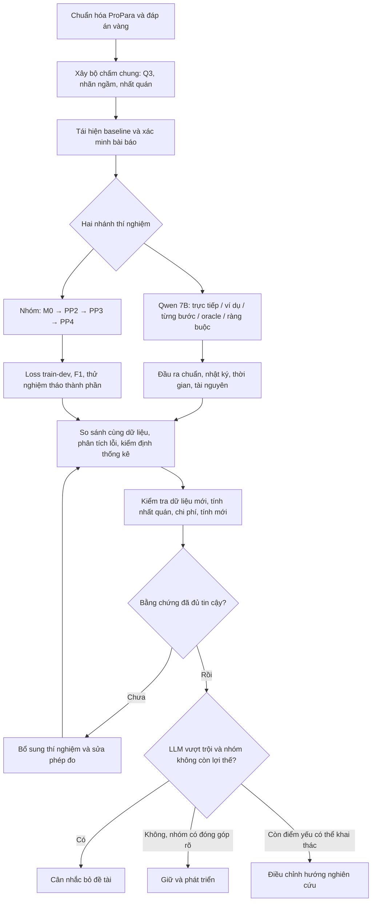

# DIỄN GIẢI GÓP Ý GIẢNG VIÊN & KẾ HOẠCH CHỨNG MINH NÊN GIỮ HAY BỎ ĐỀ TÀI

**Đề tài:** Ghép cặp chuyển đổi thực thể – Dự đoán thay đổi trạng thái ngầm trong văn bản quy trình  
**Tài liệu nền:** *Báo cáo chi tiết*, ngày 16/10/2026 (8 trang)  
**Mục tiêu của tài liệu:** Giúp các thành viên thống nhất điều giảng viên muốn nhóm kiểm chứng, các việc cần triển khai và cách dùng bằng chứng thực nghiệm để quyết định **tiếp tục – điều chỉnh – cân nhắc bỏ đề tài**.  
**Trạng thái:** Kế hoạch thực hiện; **không phải** báo cáo đã hoàn thành thực nghiệm.

> **Lưu ý về nguồn thông tin:** Nhóm chỉ nhận ý kiến giảng viên qua lời thuật lại của một thành viên. Mục **I** là cách diễn giải hợp lý từ lời thuật lại, **không phải nguyên văn lời cô**. Các quy trình, tiêu chí và phép thử chi tiết trong các mục sau là **đề xuất tổ chức nghiên cứu** dựa trên báo cáo và phần thảo luận của nhóm; cần thống nhất lại với giảng viên khi cần.

---

## I. TƯỜNG THUẬT LẠI Ý GÓP Ý CỦA GIẢNG VIÊN

### 1. Lời truyền đạt của thành viên, được diễn giải đầy đủ

> Nhóm đang đề xuất một phương pháp dự đoán sự thay đổi trạng thái của thực thể, đặc biệt là **thay đổi ngầm** (thực thể không được nhắc trực tiếp trong câu), và ghép các quan hệ chuyển đổi **X → Y**.
>
> Trước khi đầu tư quá nhiều thời gian vào kiến trúc mới, nhóm phải thử xem một mô hình ngôn ngữ lớn có sẵn, chẳng hạn **Qwen 7B chạy cục bộ**, đã giải được bài toán đến mức nào.
>
> Không nên chỉ chạy Qwen rồi nhìn vài câu trả lời. Phải đặt Qwen cạnh **phương pháp gốc**, **những phương pháp đối chứng từ bài báo liên quan**, và **phương pháp mới của nhóm**; đo điểm theo cùng tiêu chuẩn, phân tích cả **kết quả cuối cùng** và **những dự đoán trung gian có thể kiểm tra được**.
>
> Nếu Qwen đạt điểm cao hơn ở một vài phép thử thì **chưa phải lý do để bỏ đề tài**. Nhóm phải kiểm tra độ tin cậy, khả năng xử lý trường hợp ngầm, tính nhất quán, khả năng áp dụng cho dữ liệu mới, chi phí tính toán và các đóng góp riêng của giải pháp.
>
> **Chỉ khi LLM vượt trội rõ ràng, ổn định và gần như toàn diện, còn giải pháp của nhóm không chứng minh được một lợi thế đáng kể hoặc đóng góp nghiên cứu đủ rõ, nhóm mới cân nhắc dừng đề tài để chuyển hướng.**
>
> Ngược lại, nếu phương pháp nhóm giải quyết tốt một điểm yếu còn tồn tại ở LLM hay ở các phương pháp trước đó, đó là cơ sở để tiếp tục hoặc điều chỉnh hướng nghiên cứu.

### 2. Ý nghĩa cốt lõi

Đây là một **phép kiểm chứng tính đáng nghiên cứu của đề tài** (*Go/No-Go*), không đơn thuần là cuộc thi xem mô hình nào có F1 lớn nhất.

**Câu hỏi trung tâm:**

> **“Nếu Qwen 7B và các phương pháp hiện có đã làm tốt bài toán, tại sao vẫn cần nghiên cứu phương pháp PP2 + PP3 + PP4 của nhóm?”**

Mọi thí nghiệm nên tạo ra dữ liệu giúp trả lời câu hỏi này.

### 3. Hiểu đúng cụm “LLM vượt trội hoàn toàn”

Không có nghĩa là “Qwen cao hơn một chút thì bỏ”. Nhóm cần đánh giá đồng thời:

1. **Chất lượng cuối cùng:** Q3 Precision, Recall, F1 trên các cặp chuyển đổi.
2. **Năng lực cốt lõi:** CREATE/DESTROY ngầm và ghép đúng nguồn → đích.
3. **Tính nhất quán:** có dự đoán sự kiện phi lý về tồn tại hoặc nhầm chiều chuyển đổi không?
4. **Khả năng khái quát:** có còn tốt trên dữ liệu quy trình mới hoặc cách diễn đạt khác không?
5. **Độ tin cậy:** mức chênh lệch có ổn định, có khoảng tin cậy và có thể tái hiện không?
6. **Tài nguyên và đóng góp:** mô hình nhóm có ưu thế về tốc độ, bộ nhớ, chi phí hoặc một đóng góp khoa học cụ thể không?

**Nguyên tắc:** Chỉ kết luận “vượt trội toàn diện” khi bằng chứng trên các khía cạnh quan trọng đều đủ mạnh; trường hợp chưa chắc chắn thì **chưa kết luận bỏ**.

---

## II. HIỆN TRẠNG ĐỀ TÀI THEO BÁO CÁO NGÀY 16/10/2026

### 1. Bài toán và dữ liệu

- Dữ liệu **ProPara**: **488 đoạn**, **3.302 câu**, **1.915 thực thể** (theo báo cáo, mục 2).
- Với mỗi thực thể và mỗi câu, dự đoán một trong bốn nhãn: `CREATE`, `DESTROY`, `MOVE`, `NONE`; đồng thời dự đoán vị trí.
- Đầu ra bổ sung của nhóm: bộ **(X, Y, t)**, nghĩa là thực thể **X bị tiêu thụ** để tạo ra **Y** tại câu `t`.
- Trường hợp trọng tâm: thay đổi ngầm khi một thực thể thay đổi trạng thái nhưng **không được nhắc trực tiếp trong câu** (theo quy tắc nhận diện nêu trong báo cáo).
- Báo cáo suy ra **533 cặp vàng** theo cách ghép thực thể DESTROY–CREATE trong cùng câu: **378 train / 58 dev / 97 test** (mục 2.2).
- Có khoảng **130 điểm quyết định ngầm**, trong đó báo cáo nêu 57 trường hợp DESTROY và 76 trường hợp CREATE (mục 2.2). Hai số này được nêu riêng theo nhãn; không nên mặc định đây là số mẫu độc lập hoàn toàn.

### 2. Các thành phần phương pháp đã được đề xuất

| Thành phần | Vai trò theo báo cáo | Cần chứng minh gì? |
|---|---|---|
| **PP1** | LLM chấm vét cạn các khả năng, làm mốc so sánh | Khác với một lần hỏi Qwen sinh toàn bộ đáp án; cần ghi rõ cách chấm |
| **PP2** | Lọc cặp dựa trên trạng thái tồn tại | Giảm ứng viên mà không làm mất quá nhiều cặp đúng khi trạng thái được **dự đoán** |
| **PP3** | Học tri thức chuyển đổi **E(X,Y)** từ WikiHow | Tri thức cặp mang lại cải thiện thật, nhất là trường hợp ngầm |
| **PP4** | BiLSTM + CRF giải mã chung nhãn trạng thái và điểm cặp | Cải thiện dự đoán và tuân thủ các ràng buộc tồn tại |

**Thông tin phải được trình bày trung thực:** Báo cáo ở trang 1 nói rõ mới phân tích dữ liệu và thiết kế phương pháp, **chưa có kết quả huấn luyện mô hình**. Do đó, hiện tại chưa thể khẳng định PP3 + PP4 mạnh hay yếu hơn Qwen.

### 3. Điểm cần cảnh giác khi kiểm chứng

- **Cặp vàng ≠ luôn luôn là quan hệ nhân quả được xác minh độc lập.** Cách tạo cặp Q3 bằng tích Des­troy × Create cùng câu có thể sinh ra các cặp cần kiểm tra ngữ nghĩa; nên đánh giá thêm một tập nhỏ được rà soát thủ công.
- **Độ phủ PP2 = 100% với trạng thái tồn tại vàng chỉ là trần lý thuyết** theo báo cáo. Khi dùng trạng thái dự đoán, cặp vàng có thể bị lọc mất (mục 4.2).
- **WikiHow có thể lệch miền** so với các quy trình khoa học của ProPara (mục 4.5); cần đo độ phủ trước khi coi PP3 không hiệu quả.
- **ProPara đã công bố từ năm 2018**, nên kết quả LLM có nguy cơ chịu ảnh hưởng từ dữ liệu đã thấy trước. Kiểm tra thay đổi cách diễn đạt và dữ liệu mới; không diễn giải việc đổi tên vô nghĩa khiến điểm giảm là bằng chứng duy nhất về ghi nhớ.

---

## III. NĂM CÂU HỎI NHÓM PHẢI TRẢ LỜI BẰNG THỰC NGHIỆM

### Câu 1 — Phương pháp trước đây đã giải được bài toán đến đâu?

**Phải làm:** Tập hợp mô hình gốc ProPara, các quy tắc đơn giản (heuristic), CGLI và các công trình liên quan phù hợp. Kiểm tra mã nguồn, dữ liệu, định nghĩa thước đo và khả năng chạy lại.

**Bằng chứng:** Bảng kết quả có nguồn, ghi riêng **“tái hiện bằng bộ chấm chung”** và **“trích từ bài báo”**. Không ghép các F1 khác định nghĩa làm một bảng xếp hạng.

### Câu 2 — Qwen 7B thực sự có làm tốt thay đổi ngầm và chuyển đổi X → Y không?

**Phải làm:** Chốt đúng phiên bản Qwen 7B, chạy trên cùng dữ liệu và đánh giá nhiều chế độ hỏi có kiểm soát.

**Bằng chứng:** Dự đoán từng nhãn, vị trí, cặp chuyển đổi, kết quả theo từng câu và tỉ lệ lỗi. Không xem lời giải thích mà LLM tự viết như bằng chứng chắc chắn của quá trình suy luận nội bộ.

### Câu 3 — Giải pháp PP2 + PP3 + PP4 mang lại cải thiện gì?

**Phải làm:** Xây ít nhất một phiên bản khả thi để chạy đầu cuối; so sánh khi thêm, bỏ từng thành phần.

**Bằng chứng:** Bảng thử nghiệm tháo thành phần (ablation), biểu đồ huấn luyện và các lỗi được khắc phục. Khi chưa có phiên bản nhóm chạy được, **không thể kết luận nhóm thua LLM**.

### Câu 4 — Sự khác biệt có đáng tin và tái hiện được không?

**Phải làm:** Sử dụng cùng bộ chấm, khóa cách đánh giá, kiểm tra thống kê, chạy nhiều lần nếu có nguồn lực và thử trên dữ liệu mới được thiết kế hợp lệ.

**Bằng chứng:** Chênh lệch F1 kèm khoảng tin cậy 95%, cấu hình thí nghiệm, phân tích lỗi và kiểm soát rò rỉ dữ liệu.

### Câu 5 — Nếu Qwen tốt hơn thì nhóm còn đóng góp có ý nghĩa không?

**Phải làm:** Xem xét độ chính xác trên trường hợp trọng tâm, tính nhất quán, hiệu quả tài nguyên, khả năng khái quát, tính mới của ý tưởng và kết quả của từng PP.

**Bằng chứng:** Ma trận quyết định **giữ – điều chỉnh – cân nhắc bỏ**, có lý do và số liệu cụ thể.

---

## IV. DANH SÁCH 10 ĐẦU VIỆC NHÓM CẦN THỰC HIỆN

| # | Việc cần làm | Đầu ra bắt buộc | Điều kiện xem là hoàn thành |
|---|---|---|---|
| 1 | Chuẩn hóa ProPara và đáp án vàng | `data/processed/` | Kiểm tra số đoạn/câu/thực thể; trạng thái liên tục và chia tập đúng |
| 2 | Viết bộ chấm điểm chung | `src/evaluate.py`, bộ kiểm thử | Tính đúng Q3 và từng nhãn trên ví dụ tự kiểm tra; xử lý dự đoán thiếu/thừa |
| 3 | Tái hiện đối chứng | `results/baselines/` | Có mô tả nguồn, điều kiện và điểm số; phân biệt chạy lại/trích bài báo |
| 4 | Chạy Qwen 7B cục bộ | `results/qwen/` | Khóa phiên bản, cách đặt câu hỏi và cấu hình; lưu đầu ra từng ví dụ |
| 5 | Kiểm tra dự đoán trung gian | Bảng lỗi theo thực thể/câu | Đo trạng thái tồn tại, nhãn, vị trí, cặp và ràng buộc, không chỉ lấy lời giải thích |
| 6 | Huấn luyện phương pháp nhóm | `results/proposed/`, mô hình, nhật ký | Có các mốc M0–M3 và đồ thị hàm mất mát/tập kiểm định |
| 7 | Đo đóng góp từng thành phần | `reports/ablation.md` | Biết PP2, PP3, PP4 giúp hay làm hại điều gì |
| 8 | Kiểm tra độ vững và độ tin cậy | `reports/robustness.md` | Có dữ liệu kiểm tra phù hợp, phân tích sai số, khoảng tin cậy và lỗi có hệ thống |
| 9 | Đối chiếu bài báo | `reports/literature_comparison.md` | Chỉ so trực tiếp số liệu cùng thước đo; ghi rõ khác biệt |
| 10 | Tổng hợp kết quả ra quyết định | `reports/go_no_go_report.md` | Kết luận giữ/điều chỉnh/bỏ dựa trên bằng chứng; ghi giới hạn kết luận |

### Thứ tự ưu tiên khi triển khai

- **Ưu tiên 0 (phải có):** 1 → 2 → 3 → 4 → 5 → 6 → 7.
- **Ưu tiên 1 (để kết luận vững):** 8 → 9.
- **Cuối cùng:** 10, **chỉ sau khi có kết quả so sánh đủ sức kết luận**.

**Không nên bắt đầu bằng việc huấn luyện toàn bộ PP3 + PP4 trước khi kiểm tra dữ liệu, bộ chấm và mốc đối chứng.**

---

## V. CÁC CHẾ ĐỘ CHẠY QWEN ĐỂ TRÁNH SO SÁNH THIẾU CÔNG BẰNG

| Ký hiệu | Chế độ | Đầu vào được phép | Mục đích | Có dùng chấm đầu cuối? |
|---|---|---|---|---|
| Q1 | Trực tiếp, không ví dụ | Đoạn văn, danh sách thực thể, hướng dẫn định dạng | Mốc LLM cơ bản | **Có** |
| Q2 | Có một số ví dụ mẫu | Như Q1 + ví dụ chỉ lấy từ tập huấn luyện | Khả năng tận dụng ví dụ | **Có**, ghi rõ thiết lập |
| Q3 | Dự đoán có cấu trúc theo bước | Như Q1; yêu cầu trạng thái → nhãn → cặp | Biết lỗi phát sinh ở bước nào | **Có** |
| Q4 | Biết trạng thái vàng | Đoạn văn + trạng thái đúng từ đáp án | Kiểm tra **riêng** khả năng ghép cặp | **Không**; đây là kiểm tra có thông tin vàng |
| Q5 | Qwen + ràng buộc hậu xử lý | Dự đoán Qwen và luật tồn tại chung | Đo ảnh hưởng của ràng buộc logic | **Có**, nhưng tính là hệ thống Qwen + hậu xử lý |

> **Tránh nhầm tên:** “Q3” ở bảng trên là **chế độ thí nghiệm thứ 3**; **Q3 của ProPara** là tên câu hỏi/đại lượng đánh giá chuyển đổi. Trong mã nguồn nên đặt `QWEN_STRUCTURED` và `Q3_F1` để không nhập nhằng.

**Lưu ý:** PP1 trong báo cáo là **LLM chấm vét cạn bằng xác suất Yes/No**, khác với Qwen sinh đáp án trực tiếp. Nếu tái hiện PP1, cần một nhánh chạy và báo cáo chi phí riêng.

---

## VI. HIỆN THỰC PHƯƠNG PHÁP NHÓM VÀ THEO DÕI HÀM MẤT MÁT

### 1. Tháo từng thành phần để kiểm tra đóng góp

| Bản | Thành phần | Câu hỏi phải trả lời |
|---|---|---|
| **M0** | Bộ dự đoán nhãn/trạng thái cơ sở | Nếu không ghép cặp, hệ thống đã tốt đến đâu? |
| **M1** | M0 + PP2 | Lọc ứng viên giúp tăng hiệu quả bao nhiêu; bỏ sót cặp vàng không? |
| **M2** | M1 + PP3 | Tri thức WikiHow giúp dự đoán cặp ngầm tăng bao nhiêu? |
| **M3** | M2 + PP4 | Giải mã chung giúp tăng Q3 và giảm lỗi logic bao nhiêu? |

Mỗi phiên bản phải giữ các điều kiện khác tương đương tối đa; nếu kiến trúc không cho phép tách hoàn toàn, phải ghi rõ khác biệt. Nên kiểm tra thêm **M3 bỏ PP3** để tách ảnh hưởng của PP4 và tri thức WikiHow khi khả thi.

### 2. Theo dõi hàm mất mát (loss)

**PP3 – học E(X,Y):** Báo cáo định nghĩa hàm mất mát phân loại nhị phân (trang 6). Ghi lại hàm mất mát huấn luyện và kiểm định qua từng vòng, khả năng phân biệt cặp đúng/sai, kết quả theo chiều `X → Y` và chiều đảo `Y → X`.

**PP4 – giải mã chung:** Báo cáo tối đa hóa `log p(y_vàng | x)` (trang 5–6), tương đương cực tiểu `−log p(y_vàng | x)`. Ghi hàm mất mát huấn luyện/kiểm định, điểm F1 trên tập phát triển và vòng huấn luyện tốt nhất.

**Qwen 7B chỉ dùng suy luận, không huấn luyện lại:** Không có hàm mất mát huấn luyện mới để vẽ. Chỉ ghi các chỉ số đánh giá đầu ra, độ ổn định và chi phí.

**Biểu đồ phải lưu:**

- Hàm mất mát train/dev theo vòng huấn luyện của PP3 và PP4.
- Q3 F1, F1 cặp ngầm và F1 từng nhãn trên tập phát triển theo vòng huấn luyện.
- Biểu đồ M0 → M1 → M2 → M3 để quan sát đóng góp từng thành phần.
- Thời gian huấn luyện, bộ nhớ tối đa và phiên bản mô hình.

---

## VII. BỘ THƯỚC ĐO DÙNG ĐỂ CHỨNG MINH

### 1. Kết quả cuối cùng (trọng tâm)

- **Q3 Precision = TP / (TP + FP).**
- **Q3 Recall = TP / (TP + FN).**
- **Q3 F1 = 2 × Precision × Recall / (Precision + Recall).**
- Cách khớp dự đoán phải bám đúng định nghĩa bộ chấm Q3: nguồn, đích, vị trí và câu như báo cáo (mục 5). Xử lý nhất quán trường hợp mẫu số bằng 0.
- Báo cáo thêm **Q3 F1 trên các cặp có ít nhất một phía thay đổi ngầm**, nêu rõ cách định nghĩa tập con.

### 2. Chỉ số trung gian

- F1 cho `CREATE`, `DESTROY`, `MOVE`, `NONE` (nêu rõ cách tổng hợp và sự mất cân đối nhãn).
- Độ chính xác theo dõi trạng thái tồn tại của từng thực thể qua câu.
- Độ chính xác vị trí thực thể.
- Khả năng ghép cặp khi **được cung cấp trạng thái vàng** (chỉ để phân tích; không được báo là kết quả đầu cuối).
- Tỉ lệ vi phạm ràng buộc tồn tại.
- Độ phủ cặp vàng của PP2 **khi dùng trạng thái dự đoán**, so với độ phủ trần dùng trạng thái vàng.

### 3. Chỉ số độ bền và tài nguyên

- Chênh lệch Q3 F1 giữa các phương pháp **trên cùng đoạn văn**, kèm khoảng tin cậy 95% lấy mẫu lặp lại theo **đoạn**, không mặc định các cặp là độc lập.
- Kết quả với nhiều giá trị khởi tạo khi huấn luyện; độ nhạy với cách hỏi Qwen.
- Độ giảm điểm trên tập diễn đạt lại, đổi tên thực thể hợp lệ và tập mới được gán nhãn độc lập.
- Bộ nhớ GPU tối đa, thời gian xử lý trung vị và phân vị 95%, chi phí trên 1.000 đoạn nếu phù hợp.

---

## VIII. KIỂM TRA SÂU ĐỂ TRÁNH BỎ ĐỀ TÀI VÌ KẾT LUẬN VỘI

### 1. Kiểm tra chất lượng nhãn vàng

- Lấy mẫu có chủ đích từ cặp chuyển đổi ngầm và các câu có nhiều thực thể CREATE/DESTROY.
- Hai người đánh giá độc lập một tập mẫu; ghi bất đồng và cách giải quyết.
- Tách **điểm theo chuẩn ProPara** khỏi **điểm theo tập đã rà soát ngữ nghĩa**.

### 2. Kiểm tra khái quát và nguy cơ ghi nhớ

- Giữ nguyên tập kiểm tra ProPara làm mốc chính.
- Tạo tập diễn đạt lại **không đổi ý nghĩa và đáp án**.
- Tạo tập đổi tên thực thể **giữ lại tín hiệu ngữ nghĩa cần thiết**, và nếu muốn thử ẩn danh hoàn toàn thì xem đây là điều kiện khác cần diễn giải riêng.
- Bổ sung văn bản quy trình mới chưa dùng để phát triển; gán nhãn và kiểm tra chất lượng độc lập.

### 3. Danh mục lỗi để phân tích

| Nhóm lỗi | Dấu hiệu cần lưu |
|---|---|
| Bỏ sót nguồn ngầm | X nhận DESTROY nhưng không có trong dự đoán |
| Bỏ sót đích ngầm | Y nhận CREATE nhưng không có trong dự đoán |
| Nhãn sai | CREATE/DESTROY/MOVE/NONE bị nhầm |
| Sai chiều | Dự đoán Y → X thay vì X → Y |
| Cặp thừa | Dự đoán một nguồn/đích không hợp lệ hoặc không có trong nhãn vàng |
| Sai câu/vị trí | Đúng loại sự kiện nhưng sai thời điểm hay vị trí |
| Sai ràng buộc | DESTROY thực thể chưa tồn tại, CREATE thực thể đã tồn tại không phù hợp quy tắc |
| Lệch miền tri thức | Tri thức WikiHow không hỗ trợ đúng hiện tượng khoa học |

Nên chọn minh họa từ **cả ba nhóm**: Qwen đúng/nhóm sai; nhóm đúng/Qwen sai; cả hai cùng sai. Không chỉ chọn ví dụ đẹp có lợi cho phương pháp của nhóm.

---

## IX. SO SÁNH CÔNG TRÌNH LIÊN QUAN (KHÔNG NHẦM THƯỚC ĐO)

Các công trình nhóm cần xem xét:

1. **Dalvi Mishra và cộng sự (NAACL 2018)** – dữ liệu và phương pháp gốc ProPara.
2. **XPAD (2019)** – suy luận phụ thuộc giữa các bước, liên quan nhưng không mặc định cho điểm Q3 cùng định nghĩa.
3. **CGLI (COLING 2022)** – đối chứng mạnh về theo dõi thực thể.
4. **MeeT (2023)** – ứng viên đối chứng bổ sung nếu xác minh được dữ liệu, mã nguồn và thước đo phù hợp.
5. **Các nghiên cứu 2024–2025** về văn bản quy trình, thứ tự sự kiện hoặc chất lượng chú thích ProPara – sử dụng để đánh giá tính mới, thiết kế phép thử và so sánh số liệu **chỉ khi thực sự tương thích**.

**Việc bắt buộc trước khi đưa số liệu vào bảng:** đọc phần thiết lập đánh giá của từng bài; phân biệt Q3 với F1 tổng hợp, phân biệt tập dev/test, phân biệt mô hình công bố và kết quả nhóm tái hiện. Bài báo không công bố Q3 thì ghi “không công bố”, không tự suy ra.

**Mẫu bảng kết quả (chưa điền vì chưa chạy):**

| Mô hình | Nguồn kết quả | Q3 F1 | F1 CREATE ngầm | F1 DESTROY ngầm | Lỗi tồn tại | Thời gian/đoạn |
|---|---|---:|---:|---:|---:|---:|
| Heuristic | Chạy lại | — | — | — | — | — |
| ProPara gốc | Chạy lại / công bố | — | — | — | — | — |
| CGLI | Chạy lại / công bố | — | — | — | — | — |
| MeeT (nếu phù hợp) | Chạy lại / công bố | — | — | — | — | — |
| Qwen 7B – trực tiếp | Nhóm | — | — | — | — | — |
| Qwen 7B – từng bước | Nhóm | — | — | — | — | — |
| M0 / M1 / M2 / M3 | Nhóm | — | — | — | — | — |

**Quy ước:** Dấu `—` biểu thị **chưa có kết quả hoặc chưa xác nhận tính tương thích**, không phải điểm 0.

---

## X. QUY TẮC GIỮ – ĐIỀU CHỈNH – CÂN NHẮC BỎ

### Cửa 1 — Bằng chứng đã đáng tin chưa?

- [ ] Cùng dữ liệu/chia tập và bộ chấm, trừ những thí nghiệm có giải thích khác biệt.
- [ ] Có đối chứng ít nhất một heuristic và một phương pháp nghiên cứu đủ gần.
- [ ] Có kết quả chạy được của phương pháp nhóm, không chỉ là thiết kế.
- [ ] Không dùng thông tin vàng trong phép thử đầu cuối.
- [ ] Có kiểm tra độ tin cậy và phân tích lỗi, tài nguyên.

**Nếu chưa qua cửa 1: chưa quyết định bỏ.**

### Cửa 2 — Qwen có vượt trội rõ ràng và ổn định không?

- [ ] Qwen vượt trên **Q3 F1** với khoảng chênh thực tế đáng kể và khoảng tin cậy đủ hỗ trợ kết luận.
- [ ] Qwen không yếu hơn ở trọng tâm **CREATE/DESTROY ngầm và ghép cặp X → Y**.
- [ ] Kết quả vẫn vững khi thay đổi cách hỏi hợp lý và thử trên dữ liệu mới thích hợp.
- [ ] Không có lợi thế rõ của phương pháp nhóm về tính nhất quán hoặc độ tin cậy.

**Nếu chỉ Qwen nhỉnh hơn một vài điểm, chưa thể gọi là vượt trội toàn diện.**

### Cửa 3 — Đề tài còn đóng góp mới hay lợi thế đáng kể không?

- [ ] Thử nghiệm tháo thành phần cho thấy PP2/PP3/PP4 không tạo cải thiện đáng kể.
- [ ] Phương pháp nhóm không có lợi thế đủ mạnh về chi phí, tốc độ, bộ nhớ hay khả năng khái quát.
- [ ] So với những bài báo liên quan, đóng góp không còn khoảng trống nghiên cứu rõ ràng để khai thác.

### Ma trận kết luận

| Tình huống quan sát | Kết luận phù hợp |
|---|---|
| Phương pháp nhóm có lợi thế quan trọng, được kiểm chứng rõ | **GIỮ ĐỀ TÀI**; phát triển tiếp đúng lợi thế đó |
| Qwen mạnh hơn phần lớn nhưng vẫn có lỗi có hệ thống mà nhóm xử lý được | **ĐIỀU CHỈNH**; thu hẹp/đổi trọng tâm nghiên cứu |
| Qwen vượt rõ rệt, ổn định, đồng thời PP2–PP4 không đem lại lợi thế nghiên cứu hay triển khai đáng kể | **CÂN NHẮC BỎ**; trình bằng chứng để thống nhất với giảng viên |
| Độ chênh nhỏ, khoảng tin cậy rộng, dữ liệu ít hoặc PP3/PP4 chưa được thử hợp lý | **CHƯA ĐỦ BẰNG CHỨNG**; thực hiện phép thử bổ sung |

**Ngưỡng gợi ý để trao đổi với cô, không phải chuẩn bắt buộc:** Có thể đặt chênh lệch Q3 F1 khoảng **5 điểm phần trăm** là mức có ý nghĩa thực tiễn ban đầu; cần thống nhất trước khi xem điểm tập kiểm tra và bổ sung khoảng tin cậy. **Không sử dụng ngưỡng này như luật “cao hơn 5 điểm thì bỏ”.**

---

## XI. QUY TRÌNH TRIỂN KHAI ĐỀ XUẤT

### Các bước triển khai đầu tiên, theo thứ tự

1. Tạo `prepare_data.py`: chuẩn hóa đoạn/câu/thực thể/trạng thái/cặp; kiểm tra số lượng đối chiếu báo cáo.
2. Tạo `evaluate.py`: viết phép chấm Q3 chuẩn và bộ kiểm thử nhỏ để tránh sai cách tính.
3. Chạy heuristic làm mốc ban đầu và xác nhận bộ chấm hoạt động đúng.
4. Chốt bản Qwen 7B và chạy thử trên **tập phát triển**; lưu tất cả dự đoán từng ví dụ.
5. Phân tích lỗi Qwen để xác định vùng nghiên cứu khó, nhưng **không nhìn tập test để tùy chỉnh phương pháp**.
6. Thực hiện M0–M3, theo dõi huấn luyện và so sánh trên tập phát triển.
7. Khóa phương pháp, sau đó đánh giá trên tập kiểm tra cuối; bổ sung kiểm định, chi phí, tập khái quát.
8. Viết báo cáo Go/No-Go và xin ý kiến giảng viên về quyết định cuối.

---

## XII. BẢN TÓM TẮT NGẮN CÓ THỂ GỬI CẢ NHÓM HOẶC TRÌNH CÔ

> Nhóm hiểu rằng cần **kiểm chứng thực nghiệm tính cần thiết của đề tài**, thay vì chỉ đề xuất kiến trúc về mặt lý thuyết. Trước tiên, nhóm chuẩn hóa ProPara và bộ chấm, tái hiện các mốc đối chứng, rồi chạy Qwen 7B trên bài toán dự đoán trạng thái ngầm và chuyển đổi X → Y. Song song, nhóm hiện thực hóa PP2 + PP3 + PP4, theo dõi quá trình huấn luyện và kiểm tra đóng góp từng thành phần.
>
> Nhóm sẽ so sánh kết quả đầu cuối (đặc biệt Q3 F1), dự đoán trung gian, khả năng khái quát, tính nhất quán, độ ổn định, chi phí và kết quả từ các bài báo liên quan. Nhóm **không bỏ đề tài chỉ vì Qwen cao điểm hơn một chút**. Chỉ khi LLM vượt trội rõ rệt, bền vững và phương pháp nhóm không chứng minh được giá trị nghiên cứu hoặc triển khai đáng kể, nhóm mới đề xuất dừng đề tài. Nếu còn khoảng trống có thể giải quyết, nhóm tiếp tục hoặc điều chỉnh hướng nghiên cứu trên cơ sở bằng chứng.

### Câu cần trả lời trong buổi báo cáo cuối

**“Nếu Qwen 7B đã giải quyết được bài toán, nhóm có bằng chứng gì cho thấy PP2 + PP3 + PP4 vẫn đáng được nghiên cứu?”**

Nhóm phải trả lời bằng **bảng số liệu, biểu đồ, ví dụ phân tích lỗi, phép thử có kiểm soát và đối chiếu với nghiên cứu trước**, không chỉ bằng cảm nhận.

---

## XIII. GHI CHÚ TÀI LIỆU VÀ GIỚI HẠN

**Đối chiếu nội dung báo cáo gốc:**

- **Trang 1–3:** Bài toán, dữ liệu ProPara, thay đổi ngầm, lift và heuristic.
- **Trang 3–4:** Công trình liên quan; vai trò PP1, PP2, PP3, PP4.
- **Trang 5–6:** Kiến trúc, giải mã CRF, hàm mục tiêu, tri thức E(X,Y), hàm mất mát PP3.
- **Trang 7–8:** Chỉ số Q3, độ chính xác nhãn ngầm, ràng buộc, đánh giá chia chéo, rò rỉ dữ liệu và việc còn lại.

**Phần bổ sung từ kế hoạch thảo luận:** Các chế độ thử Qwen, ma trận Go/No-Go, kiểm định thống kê, phân tích nhãn vàng độc lập, kiểm tra khái quát, bảng kết quả mẫu, tiêu chí tài nguyên và các đầu việc theo thứ tự.

**Chưa thực hiện:** Chạy Qwen, huấn luyện PP3/PP4, tái hiện CGLI/MeeT, đo hiệu năng, xác minh toàn bộ kết quả từ bài báo mới. Những nội dung này là **việc phải làm**, không được mô tả thành kết quả đã chứng minh.
