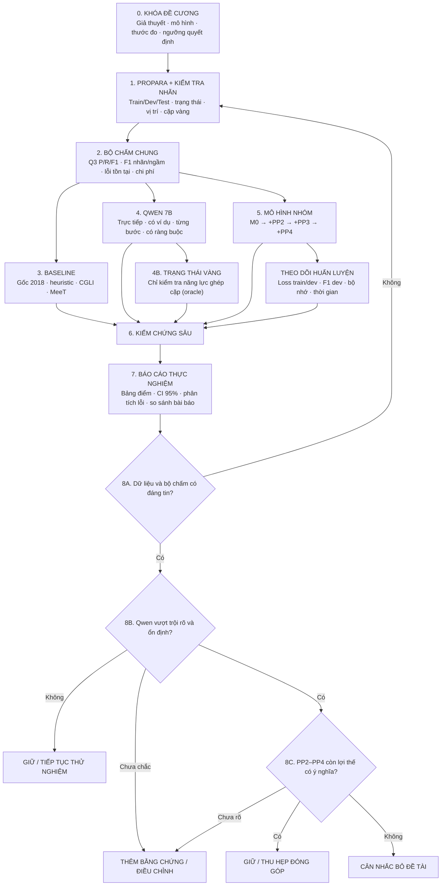

# KẾ HOẠCH KIỂM CHỨNG THỰC NGHIỆM — GIỮ, ĐIỀU CHỈNH HAY BỎ ĐỀ TÀI?

> **Đề tài:** Ghép cặp chuyển đổi thực thể — Dự đoán thay đổi trạng thái ngầm trong văn bản quy trình  
> **Nền tảng dữ liệu:** ProPara  
> **Đối chứng chính:** Qwen 7B chạy cục bộ; phương pháp gốc; heuristic; CGLI; MeeT; nghiên cứu liên quan  
> **Phương pháp nhóm:** PP2 (lọc cặp) + PP3 (tri thức X → Y) + PP4 (giải mã chung)  
> **Loại tài liệu:** Kế hoạch triển khai, quy cách thí nghiệm, tiêu chuẩn đánh giá và quyết định nghiên cứu  
> **Phiên bản kế hoạch:** 1.0 — 19/10/2026  
> **Trạng thái:** Kế hoạch; **chưa phải kết quả thực nghiệm**.

---

## MỤC LỤC

1. [Mục tiêu và nguyên tắc ra quyết định](#1-mục-tiêu-và-nguyên-tắc-ra-quyết-định)
2. [Báo cáo gốc nói gì và còn thiếu gì?](#2-báo-cáo-gốc-nói-gì-và-còn-thiếu-gì)
3. [Sơ đồ pipeline tổng thể](#3-sơ-đồ-pipeline-tổng-thể)
4. [Giai đoạn 0 — Khóa đề cương thực nghiệm](#4-giai-đoạn-0--khóa-đề-cương-thực-nghiệm)
5. [Giai đoạn 1 — Dữ liệu ProPara và kiểm tra đáp án vàng](#5-giai-đoạn-1--dữ-liệu-propara-và-kiểm-tra-đáp-án-vàng)
6. [Giai đoạn 2 — Bộ chấm điểm chuẩn](#6-giai-đoạn-2--bộ-chấm-điểm-chuẩn)
7. [Giai đoạn 3 — Các phương pháp đối chứng và bài báo](#7-giai-đoạn-3--các-phương-pháp-đối-chứng-và-bài-báo)
8. [Giai đoạn 4 — Thử nghiệm Qwen 7B](#8-giai-đoạn-4--thử-nghiệm-qwen-7b)
9. [Giai đoạn 5 — Hiện thực phương pháp nhóm và huấn luyện](#9-giai-đoạn-5--hiện-thực-phương-pháp-nhóm-và-huấn-luyện)
10. [Giai đoạn 6 — Kiểm chứng chuyên sâu](#10-giai-đoạn-6--kiểm-chứng-chuyên-sâu)
11. [Giai đoạn 7 — Bảng biểu, báo cáo và tái hiện](#11-giai-đoạn-7--bảng-biểu-báo-cáo-và-tái-hiện)
12. [Giai đoạn 8 — Tiêu chuẩn giữ/điều chỉnh/bỏ](#12-giai-đoạn-8--tiêu-chuẩn-giữđiều-chỉnhbỏ)
13. [Cấu trúc thư mục, tệp đầu ra và lệnh chạy](#13-cấu-trúc-thư-mục-tệp-đầu-ra-và-lệnh-chạy)
14. [Thứ tự ưu tiên, các mốc nghiệm thu và bảng công việc](#14-thứ-tự-ưu-tiên-các-mốc-nghiệm-thu-và-bảng-công-việc)
15. [Các sai lầm nghiên cứu phải tránh](#15-các-sai-lầm-nghiên-cứu-phải-tránh)
16. [Tài liệu tham khảo và nguồn của kế hoạch](#16-tài-liệu-tham-khảo-và-nguồn-của-kế-hoạch)

---

## 1. Mục tiêu và nguyên tắc ra quyết định

### 1.1. Câu hỏi trung tâm

**Nếu một mô hình ngôn ngữ lớn có sẵn như Qwen 7B đã xử lý rất tốt việc theo dõi trạng thái thực thể và suy ra cặp chuyển đổi ngầm X → Y, hệ thống PP2 + PP3 + PP4 do nhóm đề xuất còn đóng góp khoa học hoặc lợi ích thực tiễn nào đáng kể không?**

Không đặt mục tiêu “chứng minh nhóm tốt hơn bằng mọi giá”. Mục tiêu là **kiểm định giả thuyết bằng thực nghiệm có thể tái hiện**, rồi chọn một trong ba hướng:

- **GIỮ:** đề tài có đóng góp được chứng minh; tiếp tục nâng cấp.
- **ĐIỀU CHỈNH:** một phần đề xuất không hiệu quả nhưng còn khoảng trống nghiên cứu đáng khai thác; thu hẹp hoặc thay đổi phương pháp.
- **CÂN NHẮC BỎ:** LLM vượt trội rõ rệt và ổn định trên các khía cạnh quan trọng, trong khi nhóm không chứng minh được ưu thế hay đóng góp đủ đáng kể.

**Nguyên tắc bắt buộc:** Qwen nhỉnh hơn một ít về Q3 F1 **không phải** điều kiện đủ để bỏ. Ngược lại, phương pháp nhóm vượt Qwen trên một phép đo cũng **chưa phải** bằng chứng đã thắng toàn diện.

### 1.2. Các giả thuyết cần kiểm chứng

| Mã | Giả thuyết | Bằng chứng phải có |
|---|---|---|
| H1 | Bộ lọc PP2 giảm số cặp phải xét nhưng ít bỏ sót cặp thật | Tỉ lệ giảm ứng viên; độ phủ cặp vàng khi dùng **trạng thái dự đoán**; tốc độ |
| H2 | PP3 học được quan hệ có hướng X → Y và giúp suy ra thực thể không xuất hiện trong câu | So sánh có/không PP3; F1 trên cặp ngầm; đánh giá độc lập bộ chấm E(X,Y) |
| H3 | PP4 giải mã chung cải thiện việc gán nhãn và ghép cặp | Mô hình có/không điểm cặp; có/không giải mã chung; F1 và lỗi nhất quán |
| H4 | Qwen 7B có thể suy luận cả đầu-cuối trên ProPara mà không cần huấn luyện riêng | Qwen trực tiếp, từng bước, có ví dụ, trên cùng bộ chấm |
| H5 | Phương pháp nhóm có giá trị khi xét cả chất lượng, độ ổn định, dữ liệu mới và chi phí | Đánh giá nhiều chiều, không chỉ Q3 F1 |
| H6 | Kết luận không phải do rò rỉ dữ liệu, nhãn chưa rõ hay ngẫu nhiên | Kiểm tra nhãn vàng, thí nghiệm mới, khoảng tin cậy, nhiều lần chạy |

### 1.3. Phân biệt ba loại kết luận

1. **Kết luận mô tả:** “Mô hình A có điểm số lớn hơn B trên tập kiểm tra X”.
2. **Kết luận thống kê:** “Chênh lệch có khoảng tin cậy/kiểm định phù hợp và ổn định qua các phép thử”.
3. **Kết luận khoa học và quyết định đề tài:** “Phương pháp mới còn/không còn giá trị đáng kể khi xét cả đóng góp, độ khái quát và chi phí”.

**Không được suy trực tiếp từ (1) sang (3).**

---

## 2. Báo cáo gốc nói gì và còn thiếu gì?

### 2.1. Các dữ kiện lấy **trực tiếp** từ báo cáo ngày 16/10/2026

Nguồn chính: **“Ghép cặp chuyển đổi thực thể — Dự đoán thay đổi trạng thái ngầm trong văn bản quy trình”, Lê Như Thực, UIT, 16/10/2026**, 8 trang.

| Nội dung | Thông tin trong báo cáo | Vị trí |
|---|---|---|
| Tình trạng | Phân tích dữ liệu + thiết kế phương pháp, **chưa có kết quả huấn luyện mô hình** | Trang 1 |
| ProPara | 488 đoạn; 3.302 câu; 1.915 thực thể | Trang 1 |
| Nhãn | CREATE, DESTROY, MOVE, NONE; theo dõi vị trí ở mỗi câu | Trang 1 |
| Đầu ra bổ sung | Cặp (X, Y, t): X bị tiêu thụ để tạo ra Y tại câu t | Trang 1 |
| Cặp vàng suy từ dữ liệu | 533 cặp: train 378; dev 58; test 97 | Trang 2 |
| Điểm quyết định ngầm | Khoảng 130: 57 DESTROY; 76 CREATE | Trang 2 |
| Heuristic “nhắc gần nhất” | 74% khi chọn DESTROY ngầm; 33% khi chọn CREATE ngầm trên các điểm quyết định đã định nghĩa | Trang 3 |
| PP1 | LLM chấm vét cạn Yes/No bằng logit; tổng 331.804 câu hỏi dự kiến | Trang 4 |
| PP2 | Lọc theo trạng thái tồn tại; với trạng thái **vàng**, còn 11.144/48.070 cặp ứng viên (23%) và giữ 533/533 cặp vàng | Trang 4 |
| PP3 | E(X,Y) học ngoại tuyến từ WikiHow bằng các mẫu chuyển đổi và bộ chấm quan hệ có hướng | Trang 6–7 |
| PP4 | RoBERTa + BiLSTM, điểm đơn, điểm cặp, ràng buộc tồn tại và CRF giải mã chung | Trang 4–6 |
| Đánh giá dự kiến | Q3; nhãn ngầm; vi phạm nhất quán; chi phí; đối chứng CGLI và heuristic | Trang 7 |
| Rủi ro được nêu | WikiHow lệch miền khoa học; ProPara 2018 có khả năng nằm trong dữ liệu huấn luyện LLM | Trang 7–8 |

**Chi tiết ngân sách PP1 đã ước tính trong báo cáo (trang 4):**

| Nhóm câu hỏi vét cạn | Số lượng |
|---|---:|
| Dự đoán nhãn thực thể | 52.936 |
| Dự đoán cặp chuyển đổi | 48.070 |
| Dự đoán vị trí | 188.794 |
| Thử phương án thay thế | 42.004 |
| **Tổng** | **331.804** |

Những con số này là **số câu hỏi tiềm năng theo thiết kế PP1**, không phải chi phí đã thực chi. Nếu chạy PP1 phải lập ngân sách riêng; **không** buộc phải chạy trọn PP1 trước khi có kết quả thử Qwen trực tiếp.

**Hai điểm cần giữ chính xác:**

- “PP2 giữ 100% cặp vàng” **chỉ** là mức trần khi đầu vào bộ lọc là **trạng thái tồn tại vàng**; khi dùng trạng thái dự đoán thì phải đo lại.
- “533 cặp vàng” được suy theo phép ghép các thực thể DESTROY với CREATE trong cùng câu. Đây là **nhãn của phép đánh giá theo định nghĩa báo cáo**, chưa tự động chứng minh mọi cặp đều phản ánh quan hệ nhân quả khoa học chắc chắn.

### 2.2. Những phần **bổ sung theo kế hoạch mới** (không phải kết quả sẵn có)

- Qwen 7B dưới nhiều chế độ hỏi; Qwen cộng ràng buộc; phép thử cung cấp trạng thái vàng.
- Các bản đối chứng có thể chạy lại: ProPara 2018, CGLI 2022, MeeT 2023; bài mới hơn dùng làm tham khảo hoặc đối chứng nếu điều kiện phù hợp.
- Kiểm soát ngẫu nhiên, độ tin cậy thống kê, kiểm tra dữ liệu ngoài phân phối.
- Theo dõi hàm mất mát huấn luyện/kiểm định, biểu đồ F1, thử nghiệm bỏ từng thành phần.
- Phân tích chất lượng nhãn vàng, kiểm tra tác động của thay đổi tên và diễn đạt.
- Tiêu chuẩn định trước để giữ, điều chỉnh, hoặc cân nhắc bỏ đề tài.

---

## 3. Sơ đồ pipeline tổng thể

> Sơ đồ Mermaid có thể được xem trực tiếp trong ứng dụng hỗ trợ Mermaid (ví dụ GitHub), đồng thời là thiết kế định hướng triển khai. **Các ô kết quả chưa có số đo thực tế.**



**Luồng thực thi:** những phương pháp trong giai đoạn 3, 4, 5 **đều nhận cùng dữ liệu đầu vào và được chấm bằng cùng bộ đánh giá**, trừ các thử nghiệm đặc biệt được dán nhãn `ORACLE` hoặc `DIAGNOSTIC`.

---

## 4. Giai đoạn 0 — Khóa đề cương thực nghiệm

### Việc phải làm

- [ ] Xác định Q3 F1 **đầu cuối** là thước đo chính. Chốt các thước đo phụ quan trọng: cặp có nguồn ngầm, nhãn ngầm, độ nhất quán, độ khái quát, chi phí.
- [ ] Chốt mô hình Qwen cụ thể: mã định danh, phiên bản, dạng trọng số, mức nén, thư viện chạy, độ dài ngữ cảnh, cách sinh và phần cứng.
- [ ] Chốt danh sách baseline **bắt buộc** và **mở rộng**; mô hình nào không tái hiện được phải ghi rõ.
- [ ] Chốt cách đánh giá vị trí không rõ `?`, không tồn tại `-`, thứ tự câu và cách chuẩn hóa tên thực thể.
- [ ] Chốt ngân sách số lần chạy và số giá trị khởi tạo ngẫu nhiên; giới hạn hiệu chỉnh theo tập `dev`.
- [ ] **Đăng ký trước** mức chênh lệch có ý nghĩa thực tế. Ví dụ ban đầu: +5 điểm phần trăm Q3 F1 là mức đáng chú ý, **không phải ngưỡng chuẩn**; cần nhóm và giảng viên phê duyệt.
- [ ] Chốt tiêu chuẩn “vượt trội toàn diện” ở mục 12 **trước** khi xem điểm `test`.

### Sản phẩm

- `docs/experiment_protocol.md` — giả thuyết, phạm vi so sánh, cách chấm, ngân sách, quyết định.
- `configs/experiment.yaml` — cấu hình thí nghiệm đã khóa.
- `reports/decision_thresholds.md` — ngưỡng và lý do chọn ngưỡng.

### Điều kiện qua giai đoạn

Một thành viên khác đọc `experiment_protocol.md` có thể hiểu **mô hình nào chạy gì, dùng dữ liệu nào, theo thước đo nào và khi nào kết luận**.

---

## 5. Giai đoạn 1 — Dữ liệu ProPara và kiểm tra đáp án vàng

### 5.1. Chuẩn hóa đơn vị dữ liệu

**Đơn vị chia train/dev/test phải là cả đoạn/quy trình**, tuyệt đối không tách ngẫu nhiên các câu trong cùng đoạn sang nhiều tập.

Mỗi mẫu tối thiểu cần có:

| Trường | Ý nghĩa |
|---|---|
| `paragraph_id` | Mã đoạn/quy trình |
| `sentences` | Danh sách câu theo đúng thứ tự |
| `entities` | Danh sách thực thể và tên gọi khác nếu có |
| `states[t][i]` | Vị trí/trạng thái thực thể `i` sau câu `t`; kể cả `t=0` |
| `existence[t][i]` | Có tồn tại hay không, suy từ `states` |
| `labels[t][i]` | CREATE/DESTROY/MOVE/NONE |
| `mentions[t][i]` | Cờ thực thể có được nhắc trong câu không |
| `pairs[t]` | Các cặp `(source, target, t)` theo quy ước đánh giá |
| `split` | train/dev/test |
| `source_version` | Phiên bản dữ liệu gốc + kiểm tra toàn vẹn |

**Ví dụ cấu trúc** (minh họa, không phải mẫu thật):

```json
{
  "paragraph_id": "example_001",
  "split": "dev",
  "sentences": ["...", "Sugar is created in leaves."],
  "entities": ["carbon dioxide", "water", "sugar"],
  "state_after_each_sentence": {"0": {}, "1": {}, "2": {}},
  "labels": [
    {"sentence_id": 2, "entity": "sugar", "label": "CREATE"}
  ],
  "pairs": [
    {"sentence_id": 2, "source": "water", "target": "sugar", "location": "leaves"}
  ]
}
```

### 5.2. Suy nhãn theo báo cáo

Với `s_(i,t)` là trạng thái sau câu `t`:

- `NONE`: `s_(i,t−1) == s_(i,t)`.
- `CREATE`: trước đó là `-`, sau đó khác `-`.
- `DESTROY`: trước đó khác `-`, sau đó là `-`.
- `MOVE`: những trường hợp còn lại.

Cần kiểm thử kỹ trường hợp `?` vì báo cáo coi `?` là **tồn tại nhưng không rõ vị trí**, khác `-` là **không tồn tại**. Trong bản chấm vị trí, dấu `?` phải có quy ước đối chiếu riêng.

### 5.3. Tạo đáp án cặp theo đúng định nghĩa báo cáo

Với `D_t` là tập DESTROY và `C_t` là tập CREATE tại câu `t`:

`GoldPairs(t) = {(X,Y,t) | X ∈ D_t, Y ∈ C_t}`.

Tái lập tổng số 533 cặp vàng theo báo cáo, gồm 378/58/97 ở train/dev/test. Nếu khác, **dừng và tìm lỗi xử lý dữ liệu** trước khi chạy mô hình.

**Chú ý:** giữ một trường riêng `pair_gold_type=derived_from_states` để không nhầm “cặp được tạo từ nhãn” với “cặp nhân quả đã được chuyên gia khoa học xác nhận”.

### 5.4. Xác định thay đổi ngầm

`implicit(i,t) = (label(i,t) != NONE) AND (mentions(i,t) == 0)`.

- Báo cáo nhận diện `mentions` theo từ nội dung trong tên thực thể, xét cả biến thể số ít/số nhiều, nên có nguy cơ **đếm thiếu trường hợp ngầm**.
- Giữ nguyên định nghĩa báo cáo để tái hiện; đồng thời lập tập kiểm tra thủ công để ước lượng sai lệch nếu muốn đánh giá ngầm chặt hơn.

### 5.5. Chất lượng nhãn vàng — phần bổ sung quan trọng

- [ ] Lấy mẫu **50–100 trường hợp** thuộc nhiều loại: nguồn ngầm, đích ngầm, nhiều cặp trong một câu, vị trí khó, tên thực thể nhập nhằng.
- [ ] Hai thành viên đọc độc lập, đánh dấu: đúng theo chuẩn ProPara / quan hệ nhân quả khoa học rõ / không rõ / có khả năng sai.
- [ ] Đo mức đồng thuận (tỉ lệ đồng thuận hoặc Cohen’s kappa nếu phù hợp).
- [ ] Giải quyết bất đồng, lưu nguyên văn lý do và phiên bản chú thích đã thống nhất.
- [ ] **Không âm thầm sửa tập test gốc** rồi báo cáo như điểm ProPara chính thức; tạo tập đánh giá phụ riêng.

### Sản phẩm

`data/processed/{train,dev,test}.jsonl`, `data/processed/gold_pairs.jsonl`, `data/audit/gold_audit.csv`, `reports/dataset_validation.md`.

### Điều kiện qua giai đoạn

- Đếm đúng số đoạn, câu, thực thể, cặp theo phiên bản gốc được dùng.
- Không trùng đoạn giữa train/dev/test.
- Mọi ví dụ đều có chỉ số câu và mã thực thể nhất quán.
- Bộ kiểm tra dữ liệu tự động chạy thành công.

---

## 6. Giai đoạn 2 — Bộ chấm điểm chuẩn

### 6.1. Các thước đo bắt buộc

| Nhóm | Thước đo | Bắt buộc? | Vai trò |
|---|---|---:|---|
| Đầu cuối | Q3 Precision, Recall, F1 | **Có** | Thước đo chính để so sánh |
| Đầu cuối | Precision/Recall/F1 cho cặp có nguồn hoặc đích ngầm | **Có** | Trọng tâm đóng góp khoa học |
| Trung gian | Precision/Recall/F1 theo CREATE, DESTROY, MOVE, NONE | **Có** | Tìm lỗi gán nhãn |
| Trung gian | F1 hoặc accuracy nhận biết tồn tại theo bước | **Có** | Xác định điểm nghẽn trước ghép cặp |
| Trung gian | Vị trí chính xác / không rõ / không tồn tại | **Có** | Phân tích sai vị trí |
| Logic | Tỉ lệ vi phạm ràng buộc tồn tại | **Có** | Kiểm tra tính nhất quán |
| Kỹ thuật | Tỉ lệ đầu ra JSON hợp lệ, thực thể bịa thêm | **Có** | Đặc biệt với Qwen |
| Vận hành | Thời gian/đoạn, bộ nhớ tối đa, chi phí tính toán | **Có** | Kiểm tra ưu thế hiệu quả |
| Huấn luyện | Train loss, dev loss, dev F1 theo vòng | **Có, với mô hình có huấn luyện** | Đánh giá hội tụ/học quá khớp |
| Độ tin cậy | Chênh lệch F1 + khoảng tin cậy 95% | **Có** | Tránh kết luận từ dao động nhỏ |

### 6.2. Q3 F1 — thước đo chính

Theo báo cáo, dự đoán và đáp án vàng là các bộ `(nguồn, đích, vị trí, câu)`:

- `P = |Pred ∩ Gold| / |Pred|`
- `R = |Pred ∩ Gold| / |Gold|`
- `F1 = 2PR / (P + R)` khi mẫu số khác 0.

**Quy tắc triển khai bắt buộc:**

1. Chuẩn hóa một cách duy nhất tên thực thể, vị trí và mã câu.
2. Cố định cách xử lý trường hợp tập rỗng; dùng tổng hợp số đúng/số đoán/số vàng trên **toàn bộ tập**, không lấy trung bình F1 từng mẫu một cách tùy tiện.
3. Tái hiện bộ chấm chuẩn của ProPara nếu có thể; kết quả bổ sung theo định nghĩa riêng phải đặt tên khác và công khai mã chấm.
4. Chặn tình huống cặp dự đoán dùng thực thể không có trong danh sách cho trước; vẫn thống kê lỗi này của Qwen.
5. Chấm **đúng chiều** nguồn → đích, không xem `(X,Y)` tương đương `(Y,X)`.

### 6.3. Định nghĩa rõ bài toán ngầm

Để không nhập nhằng, xuất riêng:

- **Nguồn ngầm:** nhãn DESTROY vàng và thực thể nguồn không được nhắc ở câu.
- **Đích ngầm:** nhãn CREATE vàng và thực thể đích không được nhắc.
- **Bất kỳ phía nào ngầm:** nguồn ngầm hoặc đích ngầm.
- **Cả hai phía ngầm:** cả nguồn và đích đều không được nhắc.

Mỗi lát cắt ghi `n_gold`, `n_pred`, `n_correct`, `P`, `R`, `F1`; mẫu cực ít phải ghi cảnh báo độ bất định.

### 6.4. Lỗi ràng buộc tồn tại

Theo báo cáo, nếu thực thể **chưa tồn tại**, chỉ hợp lệ `{CREATE, NONE}`; nếu **đang tồn tại**, hợp lệ `{DESTROY, MOVE, NONE}`. Tỉ lệ vi phạm đo trên chuỗi **trạng thái dự đoán tự tiến hóa**, không được lén thay trạng thái vàng ở mỗi bước.

- Với PP4 áp đặt luật này ở giải mã, tỉ lệ vi phạm bằng 0 **theo thiết kế**.
- Vì vậy, phải báo cáo thêm `Qwen + ràng buộc` và `mô hình cơ sở + ràng buộc` để phân biệt giá trị của **luật** với giá trị học được của **mô hình**.
- Đầu ra nhất quán 100% **không đồng nghĩa** dự đoán đúng 100%.

### 6.5. Bộ kiểm thử chương trình chấm

- [ ] Dự đoán giống đáp án vàng → Q3 F1 = 1.
- [ ] Không có cặp đúng → F1 = 0 khi có cặp vàng.
- [ ] Đổi nguồn/đích → bị tính sai.
- [ ] Đúng cặp nhưng sai câu hoặc sai vị trí → xử lý đúng theo chuẩn đã khóa.
- [ ] Tập rỗng và cặp lặp → không chia cho 0, không đếm hai lần.
- [ ] Một thực thể bị DESTROY rồi DESTROY lại không CREATE → bắt được vi phạm.
- [ ] Qwen xuất mã thực thể không tồn tại → báo lỗi cấu trúc rõ ràng.
- [ ] Cùng một tệp đầu ra được chấm hai lần → điểm không đổi.

### Sản phẩm

`src/evaluation/evaluate.py`, `src/evaluation/metrics.py`, `tests/test_metrics.py`, `reports/evaluator_verification.md`.

**Chốt giai đoạn:** chỉ tiếp tục khi các phép thử trên đạt và các baseline rất đơn giản cho kết quả hợp lý; nếu không, mọi bảng so sánh đều vô nghĩa.

---

## 7. Giai đoạn 3 — Các phương pháp đối chứng và bài báo

### 7.1. Ma trận phương pháp

| Mã | Đối chứng | Thiết lập | Vai trò |
|---|---|---|---|
| B0 | Phương pháp gốc của ProPara 2018 | Chạy lại nếu có mã; nếu không, trích kết quả công bố **đúng thước đo** | Mốc lịch sử |
| B1a | Chọn ngẫu nhiên từ ứng viên hợp lệ | Nhiều seed | Cận thấp đơn giản |
| B1b | Chọn ngẫu nhiên trong thực thể không nhắc | Nhiều seed | Kiểm tra hiệu ứng tập ứng viên |
| B1c | Chọn thực thể được nhắc gần nhất | Theo mô tả báo cáo | Heuristic quan trọng |
| B2 | CGLI (COLING 2022) | Tái hiện nếu khả thi | Đối chứng học máy mạnh |
| B2b | MeeT (EACL 2023) | Tái hiện nếu khả thi | Đối chứng giải mã có ràng buộc |
| B2x | XPAD (công trình liên quan được báo cáo dẫn) | Đánh giá khả năng tái hiện trước khi đưa vào so sánh | Mốc đối chiếu về phụ thuộc bước/quy trình; **không mặc định có đầu ra cặp X→Y** |
| B2c | Nghiên cứu 2024/2025 khác | Chỉ đưa vào bảng chung nếu cùng tác vụ, dữ liệu, cách chấm | Kiểm tra tính cập nhật |
| L0 | Qwen 7B trực tiếp | Không huấn luyện lại | Đối thủ LLM chính |
| L1 | Qwen có ví dụ | Ví dụ chỉ từ train | Kiểm tra lợi ích của hướng dẫn |
| L2 | Qwen theo từng bước | Xuất dự đoán trung gian | Phân tích quy trình giải |
| L3 | Qwen + sửa theo luật tồn tại | Đầu ra dự đoán, không dùng nhãn vàng | Đối chứng có ràng buộc |
| L4 | Qwen với trạng thái vàng | **ORACLE, không so như hệ thống đầu-cuối** | Chẩn đoán riêng ghép cặp |
| L5 | PP1 chấm vét cạn Yes/No | Tùy ngân sách, khác Qwen sinh tự do | Mốc mở rộng từ báo cáo |
| M0 | Mô hình dự đoán nhãn đơn | Có huấn luyện | Nền của mô hình nhóm |
| M1 | M0 + PP2 | Có lọc theo trạng thái | Thử đóng góp lọc ứng viên |
| M2 | M1 + PP3 | Thêm E(X,Y) | Thử tri thức cặp |
| M3 | M2 + PP4 | Giải mã chung, ràng buộc | Phương pháp cuối nhóm |

**Cảnh báo tính công bằng:** báo cáo đã cho sẵn kết quả heuristic trên “điểm quyết định ngầm” (74% DESTROY, 33% CREATE) nhưng đó **không phải Q3 F1**. Không được đặt 74% vào cột Q3 F1.

### 7.2. Tiêu chuẩn đưa kết quả từ bài báo vào bảng

Với mỗi bài báo ghi:

- Tên, năm, hội nghị, URL, phiên bản mã nguồn và cách tải trọng số (nếu có).
- Tác vụ: theo dõi trạng thái hay ghép cặp Q3; có đầu ra vị trí/câu không.
- Dữ liệu: đúng ProPara gốc hay biến thể; chia tập nào.
- Thước đo: F1 nào; đánh giá chính thức hay tự định nghĩa.
- Nguồn số: **tác giả công bố** hay **nhóm tái hiện**.
- Có chuyển được sang bộ chấm của nhóm không; nếu không, ghi **không so sánh trực tiếp**.

### 7.3. Các bài tham khảo đã xác minh trang chính thức

1. **ProPara 2018:** *Tracking State Changes in Procedural Text: a Challenge Dataset and Models for Process Paragraph Comprehension* — tài liệu nền trong báo cáo gốc.
2. **CGLI 2022:** *Coalescing Global and Local Information for Procedural Text Understanding* — https://aclanthology.org/2022.coling-1.132/
3. **MeeT 2023:** *Entity Tracking via Effective Use of Multi-Task Learning Model and Mention-guided Decoding* — https://aclanthology.org/2023.eacl-main.90/
4. **Order-Based Pre-training 2024:** *Order-Based Pre-training Strategies for Procedural Text Understanding* — https://aclanthology.org/2024.naacl-short.74/
5. **ProPara-CRTS 2025:** *ProPara-CRTS: Canonical Referent Tracking for Reliable Evaluation of Entity State Tracking in Process Narratives* — https://aclanthology.org/2025.iwcs-main.22/
6. **Entity Tracking in Language Models 2023** — https://aclanthology.org/2023.acl-long.213/ (giúp thiết kế phép kiểm tra theo dõi trạng thái của LLM; không tự mặc định là baseline Q3).

**Không tự chép điểm cụ thể từ những bài này khi chưa xác nhận bảng, cách đo và dữ liệu.** Những công trình mới hỗ trợ đánh giá tính mới nhưng không phải tất cả đều có thể so sánh trực tiếp chỉ số Q3 của đề tài.

### Sản phẩm

`src/baselines/`, `references/paper_comparison.csv`, `results/baselines/`, `reports/baseline_reproduction.md`.

---

## 8. Giai đoạn 4 — Thử nghiệm Qwen 7B

### 8.1. Mô hình và môi trường

Dùng **một phiên bản cố định của Qwen 7B** làm mốc chính, ví dụ Qwen2.5-7B-Instruct: https://huggingface.co/Qwen/Qwen2.5-7B-Instruct. Đây là **gợi ý cấu hình**, không tuyên bố nhóm đã tải/chạy model.

Ghi lại: tên phiên bản, dấu kiểm trọng số nếu có, mức nén, thư viện, GPU/CPU, dung lượng bộ nhớ, số token tối đa đầu vào/đầu ra, cách chọn token, seed, phiên bản prompt.

Chọn cấu hình đủ để không bị cắt phần văn bản hoặc cấu trúc JSON; **kiểm tra riêng lỗi cắt đầu ra**. Nếu khả năng trả về xác suất/logit không được hỗ trợ, không gọi phiên bản sinh văn bản là tương đương PP1 gốc.

### 8.2. Các chế độ chạy

| Mã | Qwen nhìn thấy | Đầu ra | Điều được phép kết luận |
|---|---|---|---|
| Q0 | Đoạn văn + danh sách thực thể | Nhãn, vị trí, cặp X→Y | Năng lực đầu-cuối, không có ví dụ |
| Q1 | Như Q0 + vài ví dụ train | Như Q0 | Lợi ích khi cung cấp ví dụ |
| Q2 | Như Q0, yêu cầu các bước rõ | Tồn tại trước/sau; nhãn; vị trí; cặp; giải thích ngắn | Sai ở thành phần trung gian nào |
| Q3 | Như Q0, hậu xử lý theo luật tồn tại | Như Q0 sau ràng buộc | Lợi ích do luật, không phải riêng Qwen |
| Q4 | **Đoạn + trạng thái vàng** | Chỉ ghép cặp | Trần/chẩn đoán khả năng ghép cặp; **không so Q3 đầu-cuối trực tiếp** |
| Q5 | Các câu hỏi Yes/No chấm logit như PP1 | Điểm từng lựa chọn | Mốc vét cạn, chỉ nếu đủ khả năng kỹ thuật và ngân sách |

**Không dùng tập `dev` hoặc `test` để viết ví dụ few-shot.** Không chọn prompt tốt nhất bằng cách nhìn điểm `test` nhiều lần. Nếu thử nhiều prompt, chốt trên `dev`, khóa rồi mới mở `test`.

### 8.3. Định dạng đầu ra cố định

Mọi chế độ đầu-cuối nên xuất JSON hợp lệ tương ứng schema này (ví dụ giả lập):

```json
{
  "paragraph_id": "example_001",
  "predictions": [
    {
      "sentence_id": 2,
      "entity": "water",
      "exists_before": true,
      "action": "DESTROY",
      "exists_after": false,
      "location_after": "-"
    }
  ],
  "conversions": [
    {
      "sentence_id": 2,
      "source": "water",
      "target": "sugar",
      "location": "leaves"
    }
  ],
  "evidence_summary": "Short, observable explanation linked to the text."
}
```

Lưu **đầu ra thô** riêng với đầu ra đã làm sạch. Nếu sửa JSON, tính thêm điểm trước và sau sửa; không được sửa dự đoán bằng đáp án vàng. Với các thực thể không xuất hiện trong danh sách, báo lỗi thay vì tự thêm vào bộ đáp án.

### 8.4. “So sánh suy luận trung gian” đúng cách

Đối chiếu theo trình tự:

1. Trạng thái thực thể trước câu.
2. Sự kiện có/không được nhắc trong câu.
3. Nhãn CREATE/DESTROY/MOVE/NONE.
4. Trạng thái và vị trí sau câu.
5. Các ứng viên cặp nguồn–đích.
6. Cặp cuối cùng đúng chiều và đúng câu.
7. Lý do/bằng chứng ngắn mà mô hình tự trình bày.

**Lưu ý phương pháp luận:** văn bản giải thích do LLM tạo ra **không chứng minh đó là toàn bộ quá trình suy luận nội bộ**. Chỉ coi các dự đoán trung gian có đối chiếu được với vàng là bằng chứng đo lường; lý do dạng văn bản dùng để phân tích định tính.

### 8.5. Khung chạy thực tế

**Vòng A — kiểm tra nhanh:** 10–20 đoạn `train` đã có đáp án để kiểm tra mã; 20–30 đoạn `dev` để kiểm tra cách hỏi và định dạng; tuyệt đối chưa rút kết luận khoa học.

**Vòng B — phát triển:** chạy toàn bộ `dev`; chuẩn hóa prompt, đầu ra và độ dài; điều tra lỗi.

**Vòng C — đánh giá cuối:** chạy đúng một lần theo cấu hình đã khóa trên `test`; nếu tái đánh giá sau sửa phải báo cáo là thí nghiệm mới và quản lý việc đã sử dụng thông tin từ test.

**Vòng D — mở rộng:** dữ liệu đổi tên, viết lại, quy trình mới; đặt tên bộ kiểm tra và phiên bản rõ ràng.

### 8.6. Nhật ký cho mỗi lần chạy

`run_id`, `model_id`, `revision`, `prompt_id`, `split`, `seed`, `num_examples`, `quantization`, `gpu`, `latency_ms`, `prompt_tokens`, `output_tokens`, `valid_json`, `raw_prediction_path`, `metrics_path`.

### Sản phẩm

`src/llm/run_qwen.py`, `src/llm/prompts/`, `results/qwen/raw/`, `results/qwen/parsed/`, `results/qwen/metrics/`, `reports/qwen_intermediate_errors.md`.

---

## 9. Giai đoạn 5 — Hiện thực phương pháp nhóm và huấn luyện

### 9.1. Không nhầm kiến trúc với một chuỗi mô hình độc lập

Kiến trúc báo cáo là **mô hình phối hợp**:

- Biểu diễn ngữ cảnh bằng RoBERTa + BiLSTM.
- Điểm đơn `φ` đánh giá nhãn của từng thực thể ở mỗi câu.
- PP2 tạo danh sách cặp ứng viên dựa vào xác suất tồn tại trước câu.
- PP3 học trước tri thức có hướng `E(X,Y)` từ WikiHow.
- Điểm cặp `ψ` kết hợp `log E(X,Y)`, cờ nhắc thực thể, khoảng cách lần nhắc gần nhất và độ tương đồng ngữ cảnh.
- PP4 dùng ràng buộc tồn tại và giải mã chung để đưa ra nhãn/cặp hợp lệ; đầu vị trí chấm các cụm danh từ riêng.

**PP2 và PP3 cung cấp thành phần cho PP4**; sơ đồ `M0 → M1 → M2 → M3` là trình tự kiểm tra đóng góp, không có nghĩa PP3 sẽ tuần tự “phát nhãn” để PP4 xử lý mà không tương tác.

### 9.2. Phiên bản huấn luyện và tháo từng thành phần

| Phiên bản | Thiết lập | Kiểm tra |
|---|---|---|
| M0 | Biểu diễn ngữ cảnh + điểm đơn + dự đoán nhãn/vị trí | Chất lượng nền |
| M0c | M0 + sửa nhãn theo luật tồn tại, không có điểm cặp | Luật đóng góp bao nhiêu |
| M1 | M0 với PP2 để tạo cặp ứng viên | Tiết kiệm bao nhiêu; mất bao nhiêu vàng |
| M2 | M1 + E(X,Y) từ PP3 | Tri thức chuyển đổi có ích không |
| M2r | M1 + điểm cặp ngẫu nhiên/không dùng E | Tách hiệu ứng “thêm điểm cặp” khỏi “tri thức hữu ích” |
| M3 | PP2 + PP3 + điểm cặp + PP4 giải mã chung | Chất lượng đầy đủ |
| M3-no-E | M3 nhưng bỏ `log E(X,Y)` | Đóng góp thực của PP3 |
| M3-no-pair | M3 nhưng bỏ `ψ` | Đóng góp ghép cặp chung |
| M3-beam/exact | Giải mã xấp xỉ/chính xác nơi khả thi | Sai số thuật toán giải mã |

Nếu ngân sách nhỏ, ưu tiên **M0, M0c, M1, M2, M3, M3-no-E, M3-no-pair**. Các bản so sánh phải giữ điều kiện huấn luyện và chia tập tương đương ở mức có thể.

### 9.3. PP2 — bộ lọc theo trạng thái tồn tại

Theo báo cáo, xét cặp `(X,Y)` nếu nguồn được dự đoán có khả năng tồn tại trước câu cao và đích có khả năng chưa tồn tại trước câu cao, theo các ngưỡng `τ1, τ2` được chọn đủ lỏng.

Cần đo **hai mức riêng**:

1. `PP2-oracle`: trạng thái vàng → độ phủ trần; báo cáo có kết quả 533/533 và giảm số ứng viên còn 23%.
2. `PP2-predicted`: trạng thái mô hình dự đoán → độ phủ thật, độ giảm cặp, F1 đầu-cuối và thời gian.

Khảo sát ngưỡng `τ1, τ2` **trên dev**; thể hiện đường đánh đổi “độ phủ cặp vàng ↔ số cặp cần xét”. Không chọn ngưỡng chỉ để khớp test.

### 9.4. PP3 — huấn luyện tri thức chuyển đổi E(X,Y)

**Nguồn:** WikiHow, theo các mẫu cố định trong báo cáo như `X turns into Y`, `make Y from X`, `Y is formed from X` (và các biến thể đã được định nghĩa ở trang 6).

**Các bước:**

1. Thu thập đúng nguồn, phiên bản, giấy phép và tách bài để train/validation.
2. Tìm các câu khớp mẫu, trích cặp có hướng nguồn → đích.
3. Chuẩn hóa cụm danh từ, loại đại từ/rác nhưng lưu cả cụm gốc để kiểm tra lỗi mất nghĩa.
4. Khử trùng lặp và thống kê tần suất; đánh giá thủ công chất lượng một mẫu cặp.
5. Tạo cặp âm: đích ngẫu nhiên, đảo chiều, cùng xuất hiện nhưng không khớp mẫu. **Cặp không khớp mẫu là âm giả định, không chắc là quan hệ sai; phải kiểm soát nhiễu nhãn.**
6. Huấn luyện bộ chấm có hướng `E(X,Y)`.
7. Đo độ phủ cặp vàng, độ phủ nguồn, độ phủ đích của ProPara bằng từ vựng trong kho K.
8. Nếu độ phủ thấp vì lệch miền, kiểm chứng thêm nguồn văn bản khoa học khác; ghi thành nhánh mở rộng, không thay nguồn sau khi xem test rồi tuyên bố cùng một thử nghiệm.

**Điểm mô hình trong báo cáo:**

`r(X,Y) = u_X^T W v_Y`  
`b(X,Y) = a^T u_X + b^T v_Y + c`  
`E(X,Y) = sigmoid(r(X,Y) + b(X,Y))`.

**Hàm mất mát huấn luyện PP3 — Binary Cross-Entropy:**

`L_PP3 = -(1/N) Σ [ z log E(X,Y) + (1-z) log(1-E(X,Y)) ]`.

**Những gì phải ghi theo mỗi vòng huấn luyện:** train loss, validation loss, AUC/average precision hoặc độ chính xác xếp hạng phù hợp, kết quả cặp đảo chiều, độ phủ từ vựng, mô hình tốt nhất theo tiêu chí trên validation.

### 9.5. PP4 — giải mã chung và hàm mất mát

Theo báo cáo, điểm của cấu hình nhãn hợp lệ:

`S(y) = Σ_t [ Σ_i φ(y_ti, h_ti) + Σ_(i≠j) ψ_t(y_ti,y_tj) ]`.

Với `Y_valid` là tập chuỗi nhãn thỏa ràng buộc tồn tại:

`p(y | x) = exp(S(y)) / Σ_(y' ∈ Y_valid) exp(S(y'))`.

**Hàm mục tiêu huấn luyện PP4:**

`L_PP4 = -log p(y_gold | x)`.

Nếu có đầu vị trí hoặc hàm phụ bổ sung, phải nêu rõ công thức tổng: `L_total = L_PP4 + λ_loc·L_location + ...` **chỉ khi thật sự triển khai**; không mặc định đây là hàm sẵn có trong bản báo cáo.

**Điểm kỹ thuật cần kiểm tra:** CRF giải mã chung qua nhiều thực thể có thể đắt khi số thực thể tăng. Theo báo cáo, trường hợp ít thực thể có thể giải mã chính xác, trường hợp nhiều thực thể dùng beam search. Phải đo thời gian, kích thước chùm tìm kiếm, trường hợp thất bại và tỉ lệ kết quả bị ảnh hưởng bởi xấp xỉ.

### 9.6. Theo dõi hàm mất mát và F1

Mỗi lần huấn luyện bắt buộc tạo:

- Biểu đồ `train_loss` và `dev_loss` theo vòng.
- Biểu đồ `dev_Q3_F1`, `dev_implicit_F1` theo vòng.
- Bảng `best_epoch`, `best_dev_metric`, cấu hình mô hình tốt nhất.
- Biểu đồ thay đổi tập ứng viên PP2 và độ phủ vàng.
- Kết quả trung bình ± độ lệch chuẩn trên nhiều seed nếu có.

**Không chọn mô hình theo train loss thấp nhất.** Mô hình phải được chọn theo thước đo dev đã thống nhất trước; train/dev loss chủ yếu giúp theo dõi hội tụ và phát hiện học quá khớp.

### Sản phẩm

`src/models/`, `src/knowledge/`, `src/train/`, `checkpoints/`, `results/proposed/`, `reports/training_curves/`, `reports/ablation.csv`.

---

## 10. Giai đoạn 6 — Kiểm chứng chuyên sâu

### 10.1. Tám nhóm kiểm chứng

| Mã | Phép thử | Cách chạy | Bằng chứng đầu ra |
|---|---|---|---|
| V1 | So sánh đầu-cuối | Cùng test và cùng bộ chấm | Q3 P/R/F1; chênh lệch |
| V2 | So sánh trung gian | Nhãn, tồn tại, vị trí, cặp theo câu | Bảng lỗi từng khâu |
| V3 | Nhóm thay đổi ngầm | Nguồn ngầm, đích ngầm, cả hai ngầm | F1 từng lát cắt |
| V4 | Bỏ từng thành phần | M0/M1/M2/M3 và biến thể | Mức đóng góp PP2/PP3/PP4 |
| V5 | Khái quát dữ liệu | Đổi tên, diễn đạt lại, quy trình mới | Độ giảm so với test gốc |
| V6 | Kiểm định thống kê | Nhiều seed, lấy mẫu lặp theo đoạn | Khoảng tin cậy 95% của chênh lệch |
| V7 | Chi phí và tốc độ | Cùng máy hoặc khai báo khác biệt | ms/đoạn; bộ nhớ; lượng tính toán |
| V8 | Kiểm tra nhãn & giải thích | Chú thích kép + trường hợp sai | Tập kiểm chứng độc lập |

### 10.2. Phép thử khái quát — cần giữ đúng ý nghĩa

**Tập A: ProPara gốc.** Dùng để so với công trình trước.  
**Tập B: diễn đạt lại cùng nghĩa.** Không thay các quan hệ chuyển đổi và thứ tự sự kiện. Kiểm tra thủ công đáp án không đổi.  
**Tập C: đổi tên nhưng giữ ngữ nghĩa.** Ví dụ biến thể từ vựng tương đương; kiểm tra danh sách thực thể vẫn khớp.  
**Tập D: ẩn danh hóa thực thể.** Đánh dấu đây là **thử nghiệm mất tri thức ngữ nghĩa**: nếu Qwen giảm, chưa thể coi là bằng chứng nó “chỉ ghi nhớ”.  
**Tập E: quy trình mới.** Chú thích trạng thái/vị trí/cặp mới độc lập, không chỉ tự suy nhãn từ mô hình.

Mỗi phép thử ghi `original_id`, `variant_id`, `transformation_type`, người phê duyệt, xác nhận đáp án vẫn hợp lệ hay phải ghi lại.

### 10.3. Phân tích lỗi có hệ thống

Phân nhóm tối thiểu:

1. Bỏ sót nguồn không được nhắc.
2. Bỏ sót đích không được nhắc.
3. Nhầm CREATE/DESTROY với NONE hoặc MOVE.
4. Đúng thực thể nhưng ghép **sai chiều**.
5. Đúng cặp nhưng sai câu.
6. Sai vị trí hoặc nhầm `?` với `-`.
7. Đề xuất cặp thừa hoặc thực thể ngoài danh sách.
8. Chuỗi trạng thái không hợp lệ.
9. Suy quan hệ khoa học nghe hợp lý nhưng không được văn bản hỗ trợ.
10. Mô hình sai do nhãn vàng nhập nhằng hoặc định nghĩa “ghép tất cả D–C” quá rộng.

**Bộ phân tích định tính đề xuất:** 30–50 ví dụ đại diện, đủ 3 nhóm: Qwen đúng/nhóm sai; nhóm đúng/Qwen sai; cả hai cùng sai. Chọn bằng quy tắc công khai, không chỉ lấy ví dụ đẹp.

### 10.4. Thống kê và khoảng tin cậy

- Với điểm Q3, lấy mẫu lặp (bootstrap) theo **đoạn văn/quy trình**, không lấy từng cặp một cách độc lập vì các cặp trong cùng đoạn phụ thuộc nhau.
- Lấy mẫu **theo cặp mô hình**: mỗi lần lấy lại cùng tập đoạn cho cả Qwen và phương pháp nhóm, rồi tính `ΔF1 = F1_Qwen − F1_Group`.
- Đề xuất 2.000 lần lặp hoặc hơn tùy ngân sách; trình bày khoảng tin cậy 95% của **chênh lệch**, không chỉ hai khoảng riêng lẻ.
- Với mô hình huấn luyện, báo cáo trung bình/độ lệch theo nhiều seed (ưu tiên ≥5 nếu có tài nguyên).
- Với Qwen, có thể kiểm tra nhiều cách hỏi đã cố định và cấu hình sinh; không xem các lần chạy mô hình với cùng câu hỏi là những đoạn độc lập.
- Nếu chênh lệch không đủ chắc, kết luận **chưa đủ bằng chứng**; không viết “hai phương pháp tương đương” chỉ vì không có ý nghĩa thống kê.
- Nếu cần chứng minh không thua kém hoặc tương đương, phải định nghĩa trước **biên độ không thua kém/tương đương** và dùng kiểm định phù hợp.

### 10.5. Năm phần chia chéo và tập test chính

Báo cáo dự kiến cross-validation 5 fold trên 488 đoạn vì số điểm ngầm trong test ít. Nên phân định:

- **Đánh giá test gốc:** dùng để so sánh chuẩn ProPara, chỉ đánh giá sau khi khóa thiết lập.
- **Đánh giá chia chéo 5 phần:** kết quả bổ sung; các phần phải chia theo đoạn/chủ đề, có bước điều chỉnh tham số **bên trong phần huấn luyện**; không được dùng chính phần kiểm tra của mỗi fold để chọn mô hình rồi báo điểm trên đó.
- Không gộp điểm cross-validation với điểm test chính như thể đó là cùng một bộ kiểm tra độc lập.

### 10.6. Hiệu quả tài nguyên

| Chỉ số | Cách lưu |
|---|---|
| `latency_p50_ms`, `latency_p95_ms` | Đo theo đoạn, có chạy làm nóng thiết bị |
| `paragraphs_per_sec` | Khối lượng xử lý, cùng điều kiện tải |
| `peak_gpu_memory_gb` | Đỉnh bộ nhớ đồ họa |
| `prompt_tokens`, `output_tokens` | Với Qwen |
| `train_gpu_hours` | Với các mô hình huấn luyện |
| `inference_gpu_hours_per_1000_paragraphs` | Chuẩn hóa chi phí xử lý |
| `failure_rate` | Lỗi bộ nhớ, cắt nội dung, JSON sai, hết thời gian |

Nếu không dùng cùng phần cứng thì phải ghi điều kiện và hạn chế của phép so tốc độ. Phân biệt **chi phí huấn luyện một lần** với **chi phí xử lý thường xuyên**.

---

## 11. Giai đoạn 7 — Bảng biểu, báo cáo và tái hiện

### 11.1. Bảng kết quả **chính** — tuyệt đối để trống trước khi chạy

| Mô hình | Q3 P | Q3 R | Q3 F1 | F1 cặp ngầm | Lỗi tồn tại | ms/đoạn | Nguồn |
|---|---:|---:|---:|---:|---:|---:|---|
| ProPara 2018 | — | — | — | — | — | — | Công bố/tái hiện, xác nhận sau |
| Heuristic | — | — | — | — | — | — | Nhóm chạy |
| CGLI 2022 | — | — | — | — | — | — | Công bố/tái hiện, xác nhận sau |
| MeeT 2023 | — | — | — | — | — | — | Công bố/tái hiện, xác nhận sau |
| Qwen Q0 | — | — | — | — | — | — | Nhóm chạy |
| Qwen Q1/Q2/Q3 | — | — | — | — | — | — | Nhóm chạy |
| M0 | — | — | — | — | — | — | Nhóm chạy |
| M1 (+PP2) | — | — | — | — | — | — | Nhóm chạy |
| M2 (+PP3) | — | — | — | — | — | — | Nhóm chạy |
| M3 (+PP4) | — | — | — | — | — | — | Nhóm chạy |

**Qwen Q4 dùng trạng thái vàng phải nằm trong bảng phụ riêng** có tiêu đề `ORACLE/DIAGNOSTIC`, không được xếp hạng ngang với Qwen Q0 và M3 đầu-cuối.

### 11.2. Bảng trung gian

| Mô hình | F1 CREATE ngầm | F1 DESTROY ngầm | F1 MOVE | Acc tồn tại | Acc vị trí | Đúng chiều cặp |
|---|---:|---:|---:|---:|---:|---:|
| Qwen Q2 | — | — | — | — | — | — |
| Qwen Q4 (oracle) | Không áp dụng | Không áp dụng | Không áp dụng | Được cung cấp vàng | Không áp dụng nếu không dự đoán | — |
| M0 | — | — | — | — | — | — |
| M2 | — | — | — | — | — | — |
| M3 | — | — | — | — | — | — |

### 11.3. Những biểu đồ cần xuất tự động

1. `01_q3_f1_comparison.png`: Q3 F1 của các mô hình **cùng bộ chấm** + thanh sai số khi có.
2. `02_implicit_f1.png`: F1 cặp có nguồn ngầm/đích ngầm/cả hai ngầm.
3. `03_per_label_f1.png`: CREATE/DESTROY/MOVE/NONE.
4. `04_pp3_train_dev_loss.png`: hàm mất mát PP3.
5. `05_pp4_train_dev_loss.png`: hàm mất mát PP4.
6. `06_dev_f1_by_epoch.png`: Q3 F1 theo vòng huấn luyện.
7. `07_ablation.png`: chênh lệch M0/M1/M2/M3 và biến thể tháo thành phần.
8. `08_filter_tradeoff.png`: số ứng viên còn lại so với độ phủ cặp vàng của PP2.
9. `09_robustness.png`: độ giảm điểm khi đổi tên/viết lại/quy trình mới.
10. `10_cost_quality.png`: Q3 F1 so với thời gian hoặc bộ nhớ xử lý.
11. `11_error_distribution.png`: phân bố lỗi theo loại.
12. `12_confidence_interval.png`: khoảng tin cậy cho `ΔQ3 F1`.

### 11.4. Mẫu nhận xét kết quả — chỉ điền sau khi có số

> Trên tập kiểm tra [tên, phiên bản], Qwen [cấu hình] đạt Q3 F1 = [ ], trong khi mô hình M3 đạt [ ]; chênh lệch Qwen − M3 = [ ] điểm phần trăm, khoảng tin cậy 95% là [ , ]. Trên tập có nguồn ngầm, các giá trị lần lượt [ ] và [ ]. PP3 làm thay đổi F1 ngầm [ ] điểm so với phiên bản không có PP3. Chi phí suy luận mỗi 1.000 đoạn là [ ] so với [ ]. Các phép thử trên tập mới cho thấy [ ]. **Vì vậy, kết luận hiện tại là [giữ/điều chỉnh/chưa đủ bằng chứng/cân nhắc bỏ], với giới hạn [ ].**

### 11.5. Tái hiện

Mỗi kết quả phải có: phiên bản dữ liệu, phiên bản mã nguồn, tệp cấu hình, seed, mô hình/trọng số, lệnh chạy, đầu ra thô, đầu ra chuẩn, báo cáo lỗi và tệp số liệu dùng tạo biểu đồ.

---

## 12. Giai đoạn 8 — Tiêu chuẩn giữ/điều chỉnh/bỏ

### 12.1. **Ba cửa** trước khi kết luận

**Cửa A — Dữ liệu và phép đo có đáng tin?**

- Dữ liệu được kiểm tra và giữ nguyên bộ test chính thức.
- Cùng một bộ chấm Q3; không lẫn điểm bài báo khác thước đo.
- Không dùng trạng thái vàng cho kết quả so sánh đầu-cuối.
- Không chọn prompt/mô hình dựa trên việc thử lặp đi lặp lại test.
- Có đầu ra thô, cấu hình, biểu đồ và tập lỗi đối chiếu được.

**Không qua cửa A ⇒ chưa được kết luận bỏ/giữ từ điểm số.**

**Cửa B — Qwen có vượt trội rõ rệt và ổn định không?**

- Qwen tốt hơn rõ trên **Q3 F1 đầu-cuối**, thước đo cốt lõi của đề tài.
- Lợi thế không biến mất khi xét **cặp ngầm**, không chỉ mẫu dễ.
- Chênh lệch đủ lớn về **ý nghĩa thực tế**, không chỉ dương 0,1–1 điểm.
- Đánh giá thống kê cho thấy lợi thế được ủng hộ; nhiều lần chạy và thử nghiệm dữ liệu mới không đảo ngược kết luận một cách bất thường.
- Qwen không “thắng” nhờ được cấp đáp án vàng hoặc hưởng điều kiện không công bằng.

**Cửa C — PP2/PP3/PP4 có còn đóng góp đáng kể không?**

- Có hiệu quả riêng từng thành phần qua thử nghiệm tháo thành phần không?
- Có giảm bỏ sót nguồn ngầm, sai cặp hoặc lỗi tồn tại không?
- Có lợi thế về tốc độ, bộ nhớ, chi phí vận hành hoặc tính ổn định không?
- Có khoảng trống khoa học cụ thể mà các công trình 2018–2025 chưa giải quyết rõ không?
- Có khả năng làm thành đóng góp nghiên cứu độc lập, không chỉ chắp ghép kiến trúc không cần thiết không?

### 12.2. Ma trận quyết định

| Tình huống | Quyết định hợp lý | Giải thích |
|---|---|---|
| M3 vượt Qwen ở Q3 hoặc có lợi thế quan trọng được kiểm chứng | **GIỮ** | Có đóng góp đáng theo đuổi |
| Qwen nhỉnh hơn Q3 nhưng M3 xử lý nguồn ngầm tốt hơn rõ hoặc hiệu quả hơn nhiều | **GIỮ/THU HẸP** | Chưa phải vượt trội toàn diện |
| Qwen rất mạnh, M3 yếu ở dự đoán tồn tại nhưng ghép cặp tốt khi có trạng thái đúng | **ĐIỀU CHỈNH** | Sửa điểm nghẽn, cân nhắc mô hình hướng dẫn |
| PP3 không tăng chất lượng nhưng PP4 vẫn có ích | **ĐIỀU CHỈNH** | Loại hoặc thiết kế lại PP3; chưa đủ lý do bỏ toàn bộ |
| Qwen chỉ hơn trên test gốc, không hơn trên dữ liệu mới | **CHƯA BỎ** | Cần giải thích sự khác biệt |
| Điểm gần nhau, khoảng tin cậy rộng | **CHƯA KẾT LUẬN** | Cần thêm dữ liệu hoặc cải thiện thiết kế đánh giá |
| Qwen vượt rõ, ổn định trên các tác vụ chính, còn M3 không có ưu thế chất lượng/tài nguyên/tính mới đáng kể | **CÂN NHẮC BỎ** | Mục tiêu nghiên cứu có nguy cơ không còn lý do theo đuổi |

### 12.3. Ngưỡng tham khảo để nhóm thống nhất với giảng viên

> **Tất cả ngưỡng dưới đây chỉ là đề xuất trước thí nghiệm, KHÔNG phải sự thật đã chứng minh hay tiêu chuẩn chung của lĩnh vực.**

- Mức chênh lệch Q3 F1 đáng chú ý về mặt thực tế: **ví dụ +5 điểm phần trăm**. Nhóm phải thống nhất chính thức; +5 không tự động đủ để bỏ.
- Ưu tiên 95% khoảng tin cậy của `ΔF1 = Qwen − M3` **không chứa 0** khi muốn khẳng định Qwen tốt hơn có bằng chứng thống kê; nếu cỡ mẫu quá ít, không cưỡng ép kết luận.
- Yêu cầu kiểm tra tối thiểu: test gốc + ít nhất một tập đổi cách diễn đạt/tên **hợp lệ** + phân tích cặp ngầm + chi phí và độ ổn định.
- Một phép thử thất bại, không rõ hoặc thiếu dữ liệu **không được tự động đổi thành phiếu “bỏ”**.
- Nếu phương pháp nhóm chưa được hiện thực ở mức đủ tin cậy, chỉ có thể kết luận **“chưa chứng minh được đề tài”**, không phải **“LLM đã chứng minh đề tài thất bại”**.

### 12.4. Quyết định cuối được ghi thành biên bản

Biên bản có:

1. Kết luận được chọn (`KEEP` / `PIVOT` / `INSUFFICIENT_EVIDENCE` / `CONSIDER_STOP`).
2. Những thước đo hỗ trợ trực tiếp.
3. Những kết quả trái chiều.
4. Khoảng tin cậy và giới hạn dữ liệu.
5. Lợi thế còn lại của PP2/PP3/PP4 hoặc lý do không còn lợi thế.
6. Chi phí và thời gian cần cho thí nghiệm bổ sung (nếu chưa đủ bằng chứng).
7. Người duyệt và ngày chốt.

---

## 13. Cấu trúc thư mục, tệp đầu ra và lệnh chạy

### 13.1. Cấu trúc dự án đề xuất

```text
propara-go-no-go/
├── README.md
├── requirements.txt                # Hoặc tệp mô tả môi trường tương đương
├── configs/
│   ├── experiment.yaml
│   ├── qwen_q0.yaml
│   ├── qwen_q2.yaml
│   ├── pp3.yaml
│   └── pp4.yaml
├── data/
│   ├── raw/                        # Giữ nguyên nguồn
│   ├── processed/                  # train/dev/test + nhãn/cặp
│   ├── audit/                      # Kiểm tra vàng
│   └── robustness/                 # Biến thể kiểm tra bổ sung
├── docs/
│   ├── experiment_protocol.md
│   ├── data_dictionary.md
│   └── decision_thresholds.md
├── references/
│   └── paper_comparison.csv
├── src/
│   ├── data/
│   │   ├── prepare_data.py
│   │   ├── validate_data.py
│   │   └── audit_gold.py
│   ├── evaluation/
│   │   ├── evaluate.py
│   │   ├── metrics.py
│   │   └── paired_bootstrap.py
│   ├── baselines/
│   │   ├── heuristic.py
│   │   └── adapters/
│   ├── llm/
│   │   ├── run_qwen.py
│   │   ├── parse_predictions.py
│   │   └── prompts/
│   ├── knowledge/
│   │   ├── extract_wikihow_pairs.py
│   │   ├── train_pair_score.py
│   │   └── measure_coverage.py
│   ├── models/
│   │   ├── encoder.py
│   │   ├── candidate_filter.py
│   │   ├── pair_score.py
│   │   └── joint_decoder.py
│   ├── train/
│   │   ├── train_baseline.py
│   │   └── train_joint.py
│   └── analysis/
│       ├── error_analysis.py
│       ├── robustness.py
│       ├── benchmark_cost.py
│       └── make_figures.py
├── tests/
│   ├── test_data_integrity.py
│   ├── test_metrics.py
│   ├── test_qwen_schema.py
│   └── test_constraints.py
├── checkpoints/                    # Không tự đưa trọng số lớn lên git
├── results/
│   ├── baselines/
│   ├── qwen/
│   ├── proposed/
│   └── comparison/
└── reports/
    ├── dataset_validation.md
    ├── training_curves/
    ├── error_cases.csv
    ├── figures/
    ├── paper_comparison.md
    └── go_no_go_final.md
```

### 13.2. Thứ tự lệnh chạy — **mẫu dự kiến**, chưa phải mã đã được tạo

```bash
# 1. Chuẩn hóa + kiểm tra dữ liệu
python -m src.data.prepare_data --config configs/experiment.yaml
python -m src.data.validate_data --config configs/experiment.yaml

# 2. Kiểm thử bộ chấm
python -m pytest tests/test_metrics.py tests/test_data_integrity.py

# 3. Heuristic trước để kiểm tra toàn luồng
python -m src.baselines.heuristic --split dev
python -m src.evaluation.evaluate --pred results/baselines/heuristic_dev.jsonl --split dev

# 4. Qwen trên dev, trước khi chạy test
python -m src.llm.run_qwen --config configs/qwen_q0.yaml --split dev
python -m src.llm.run_qwen --config configs/qwen_q2.yaml --split dev

# 5. PP3, PP4
python -m src.knowledge.extract_wikihow_pairs
python -m src.knowledge.train_pair_score --config configs/pp3.yaml
python -m src.train.train_joint --config configs/pp4.yaml

# 6. Đánh giá, phân tích lỗi, biểu đồ
python -m src.analysis.error_analysis --split dev
python -m src.analysis.make_figures
```

**Ghi chú:** các lệnh trên là giao diện mong muốn để triển khai sau, **chưa được khẳng định chạy được**. Khi tạo mã thực, phải kiểm tra cả đường dẫn, môi trường, cấu hình GPU và định dạng đầu ra.

### 13.3. Chuẩn một bản ghi thí nghiệm

```yaml
run_id: qwen_q0_dev_seed42
experiment_stage: development
model_id: Qwen2.5-7B-Instruct
model_revision: TO_BE_FILLED
split: dev
seed: 42
prompt_version: q0_v1
train_data_version: propara_original
scorer_version: scorer_v1
hardware: TO_BE_FILLED
inference_parameters: TO_BE_FILLED
predictions_path: results/qwen/q0_dev.jsonl
metrics_path: results/qwen/q0_dev_metrics.json
notes: no_gold_state_provided
```

---

## 14. Thứ tự ưu tiên, các mốc nghiệm thu và bảng công việc

### 14.1. Ưu tiên thực thi

**P0 — Bắt buộc để có kết luận ban đầu đáng tin:**

1. Dữ liệu chuẩn + bộ chấm kiểm thử được.
2. Heuristic và ít nhất một đối chứng mạnh có đầu ra/điểm đúng thước đo.
3. Qwen Q0 (trực tiếp), Q2 (trung gian), Q3 (có ràng buộc), Q4 (oracle tách riêng).
4. M0 và phiên bản M3 khả thi; thử nghiệm có/không PP3/điểm cặp.
5. Q3 đầu-cuối, F1 cặp ngầm, phân tích lỗi, chênh lệch và khoảng tin cậy.
6. Biên bản quyết định theo ba cửa.

**P1 — Rất nên làm để chứng minh vững:**

- Qwen có ví dụ; các nghiên cứu đối chứng mới tái hiện được.
- PP3 độ phủ tri thức; PP2 đánh đổi lọc ứng viên.
- Kiểm tra nhãn vàng có hai người chấm.
- Diễn đạt lại, đổi tên đúng nghĩa, quy trình mới.
- Chi phí, tốc độ, nhiều seed và biểu đồ huấn luyện đầy đủ.

**P2 — Mở rộng nếu còn nguồn lực:**

- PP1 vét cạn bằng logit Yes/No; đây có thể là phép thử rất tốn tài nguyên.
- Một LLM mạnh hơn hoặc kích thước khác để kiểm tra tính tổng quát của kết luận.
- Cải thiện WikiHow bằng nguồn tri thức khoa học, nhưng phải thiết kế như **thí nghiệm bổ sung** có kiểm soát.
- Chưng cất khả năng Qwen sang mô hình nhỏ và so với PP2–PP4.

### 14.2. Các mốc nghiệm thu (gates)

| Mốc | Phải hoàn thành | Nếu chưa đạt |
|---|---|---|
| G0 | Đề cương và ngưỡng khóa | Chưa chạy test cuối |
| G1 | Dữ liệu và bộ chấm đúng | Sửa dữ liệu/bộ chấm |
| G2 | Heuristic chạy đúng; Qwen xuất JSON hợp lệ | Sửa pipeline đầu vào/đầu ra |
| G3 | Các baseline và Qwen đã có điểm dev | Không kết luận dựa trên ví dụ lẻ |
| G4 | M3 huấn luyện/giải mã ổn định, có loss và F1 dev | Chẩn đoán huấn luyện, không coi M3 là “đã thất bại” |
| G5 | Cấu hình cố định; kết quả test và thống kê hoàn chỉnh | Bổ sung kiểm định/tránh rò rỉ |
| G6 | Phân tích nhãn, lỗi, tính mới, tài nguyên | Không kết luận “vượt trội toàn diện” |
| G7 | Biên bản giữ/điều chỉnh/bỏ | Ghi “chưa đủ bằng chứng” nếu cần |

### 14.3. Bảng công việc để phân công

| ID | Việc | Đầu ra | Ưu tiên | Trạng thái |
|---|---|---|---|---|
| T01 | Khóa đề cương, ngưỡng, cấu hình | `experiment_protocol.md` | P0 | ☐ |
| T02 | Chuyển ProPara thành dữ liệu chuẩn | `data/processed/` | P0 | ☐ |
| T03 | Đối chiếu 533 cặp vàng và kiểm tra tách tập | `dataset_validation.md` | P0 | ☐ |
| T04 | Viết và kiểm thử Q3 scorer | `evaluate.py`, test | P0 | ☐ |
| T05 | Chạy heuristic các loại | `results/baselines/` | P0 | ☐ |
| T06 | Lập bảng bài báo, tái hiện CGLI/MeeT nếu khả thi | `paper_comparison.csv` | P0/P1 | ☐ |
| T07 | Chạy Qwen Q0 trên dev | JSON thô + chấm điểm | P0 | ☐ |
| T08 | Chạy Qwen Q2/Q3/Q4 | Đánh giá trung gian/oracle | P0 | ☐ |
| T09 | Huấn luyện M0 + M0c | Loss + F1 dev | P0 | ☐ |
| T10 | Đo PP2, ngưỡng và độ phủ cặp vàng | Biểu đồ lọc ứng viên | P0 | ☐ |
| T11 | Trích WikiHow + huấn luyện PP3 | `E(X,Y)` + loss | P0 | ☐ |
| T12 | Huấn luyện M3 và tháo từng thành phần | Checkpoint + ablation | P0 | ☐ |
| T13 | Chạy test theo cấu hình đã khóa | Bảng điểm chính | P0 | ☐ |
| T14 | Bootstrap + nhiều seed | CI 95% và biến động | P0 | ☐ |
| T15 | Phân tích 30–50 lỗi đại diện | `error_cases.csv` | P0 | ☐ |
| T16 | Chú thích lại 50–100 mẫu độc lập | `gold_audit.csv` | P1 | ☐ |
| T17 | Kiểm tra đổi tên, viết lại, quy trình mới | Biểu đồ robustness | P1 | ☐ |
| T18 | Đo tốc độ, GPU, lỗi chạy | Bảng chi phí | P1 | ☐ |
| T19 | Tạo toàn bộ biểu đồ/bảng cho báo cáo | `reports/figures/` | P0 | ☐ |
| T20 | Chấm ba cửa và viết biên bản | `go_no_go_final.md` | P0 | ☐ |

### 14.4. Việc cần làm **ngay đầu tiên**

Không bắt đầu bằng train PP4 hoặc tải toàn bộ WikiHow. Hãy bắt đầu **T01 → T02 → T03 → T04 → T05**.

Lý do: nếu bộ chấm Q3 chưa tái hiện được và dữ liệu không đúng, mọi so sánh Qwen hay biểu đồ hàm mất mát về sau đều không thể bảo vệ trước giảng viên.

---

## 15. Các sai lầm nghiên cứu phải tránh

1. **Lấy điểm Qwen cao hơn một ít rồi bỏ đề tài.** Đây không phải tiêu chuẩn “vượt trội toàn diện”.
2. **Dùng trạng thái vàng cho Qwen nhưng không cấp cho phương pháp nhóm**, rồi gọi là so sánh đầu-cuối công bằng.
3. **Nhập nhằng PP1 với Qwen sinh câu trả lời.** PP1 trong báo cáo là chấm Yes/No bằng logit, khác cách yêu cầu Qwen xuất JSON tự do.
4. **Dùng điểm F1 trạng thái trong bài báo làm Q3 F1.** Không cùng đơn vị đo.
5. **Dùng trạng thái vàng để khoe PP2 giữ 100% cặp**, nhưng không đo lại với trạng thái dự đoán.
6. **Khẳng định phương pháp mới thất bại khi chưa huấn luyện hoặc chưa ổn định.** Chỉ kết luận là chưa được kiểm chứng đầy đủ.
7. **Chọn prompt/ngưỡng/hyperparameter trên test.** Đây là sử dụng thông tin kiểm tra để hiệu chỉnh, làm mất tính độc lập của kết quả.
8. **Tin tuyệt đối vào lời giải thích do Qwen sinh.** Cần đo dự đoán trung gian và đối chiếu vàng; lời giải thích chỉ là văn bản quan sát được.
9. **Tự sửa nhãn vàng chính thức mà không báo.** Chú thích bổ sung phải là tập riêng.
10. **Đọc giảm điểm ở tập đổi tên như bằng chứng học thuộc.** Nếu phép đổi tên làm mất ý nghĩa, đó là một bài toán khác.
11. **So thời gian giữa hai GPU khác nhau như cùng điều kiện.** Phải nói rõ giới hạn.
12. **Dùng tỉ lệ vi phạm = 0 của mô hình có ràng buộc làm bằng chứng suy luận chính xác.** Đó có thể chỉ là tính chất của thuật toán giải mã.
13. **Không lưu trường hợp sai/thất bại.** Tỉ lệ JSON hỏng, hết bộ nhớ, câu không trả lời là kết quả phải báo cáo.
14. **Chỉ báo kết quả lần chạy đẹp nhất.** Phải ghi điều kiện chọn, seed, độ biến động và giới hạn.
15. **Nói “hai phương pháp tương đương” chỉ vì kiểm định không phát hiện khác biệt.** Không có bằng chứng khác biệt ≠ bằng chứng tương đương.
16. **Đồng nhất cặp D–C cùng câu với quan hệ nhân quả chắc chắn.** Phải tách đúng chuẩn đánh giá và đối chiếu ngữ nghĩa khoa học.
17. **Chia dữ liệu theo câu.** Các câu cùng đoạn phải nằm cùng một tập để tránh rò rỉ ngữ cảnh.
18. **Chỉ chứng minh Qwen 7B kém rồi nói mọi LLM kém.** Kết luận chỉ áp dụng cho model/cấu hình và bộ kiểm tra đã dùng.

---

## 16. Tài liệu tham khảo và nguồn của kế hoạch

### 16.1. Nguồn nội bộ do nhóm cung cấp

- **Lê Như Thực.** *Ghép cặp chuyển đổi thực thể — Dự đoán thay đổi trạng thái ngầm trong văn bản quy trình*. Báo cáo tiến độ UIT, 16/10/2026, 8 trang. Đây là nguồn cho định nghĩa bài toán, các con số ProPara, PP1–PP4 và công thức nêu ở mục 2, 5, 9.

### 16.2. Bài báo bên ngoài đã kiểm tra trang công bố

- Ma et al. (2022). *Coalescing Global and Local Information for Procedural Text Understanding*. COLING. https://aclanthology.org/2022.coling-1.132/
- Singh, Bai & Wang (2023). *Entity Tracking via Effective Use of Multi-Task Learning Model and Mention-guided Decoding*. EACL. https://aclanthology.org/2023.eacl-main.90/
- Kim & Schuster (2023). *Entity Tracking in Language Models*. ACL. https://aclanthology.org/2023.acl-long.213/
- Nandy et al. (2024). *Order-Based Pre-training Strategies for Procedural Text Understanding*. NAACL. https://aclanthology.org/2024.naacl-short.74/
- Ye et al. (2025). *ProPara-CRTS: Canonical Referent Tracking for Reliable Evaluation of Entity State Tracking in Process Narratives*. IWCS. https://aclanthology.org/2025.iwcs-main.22/
- Qwen2.5-7B-Instruct (mô hình tham khảo, cần khóa phiên bản khi chạy): https://huggingface.co/Qwen/Qwen2.5-7B-Instruct

### 16.3. Tuyên bố phạm vi

- Các số liệu “488 đoạn”, “533 cặp”, “74% heuristic”, “11.144/48.070 cặp ứng viên” lấy từ **báo cáo 16/10/2026**, **chưa được tự tái hiện trong tệp kế hoạch này**.
- Các đường dẫn bài báo là để đọc, kiểm tra tính liên quan và tái hiện sau; tài liệu này **không khẳng định** mọi bài có mã nguồn tương thích hay có sẵn Q3 F1.
- Các mức thử nghiệm, số mẫu chú thích, số lần bootstrap, cách đặt ngưỡng và danh mục biểu đồ là **đề xuất triển khai**, không phải nội dung giảng viên đã xác nhận nguyên văn.
- Không có điểm Qwen, điểm PP3/PP4, biểu đồ loss thực tế hoặc kết luận giữ/bỏ nào được tạo ra từ tài liệu này.

---

## TÓM TẮT ĐIỀU HÀNH CHO NHÓM VÀ GIẢNG VIÊN

**Bài toán:** suy trạng thái và quan hệ chuyển đổi X → Y, đặc biệt khi thực thể không được nhắc trực tiếp trong câu.

**Cách kiểm chứng:** dùng chung ProPara và bộ chấm Q3 để so sánh phương pháp gốc, heuristic, các đối chứng nghiên cứu, Qwen 7B và phương pháp PP2 + PP3 + PP4; đo cả kết quả cuối, trạng thái trung gian, chuyển đổi ngầm, tính nhất quán, độ khái quát và chi phí; có biểu đồ huấn luyện và kiểm định thống kê.

**Tiêu chuẩn ra quyết định:** **không bỏ đề tài chỉ vì thua Qwen**. Chỉ cân nhắc bỏ khi Qwen có ưu thế rõ rệt, ổn định, đáng kể trên nhiệm vụ cốt lõi và các phép thử bổ sung, trong khi phương pháp nhóm không có đóng góp chất lượng, tính mới hoặc hiệu quả đủ thuyết phục. Nếu chưa đủ bằng chứng: **điều chỉnh hoặc tiếp tục kiểm chứng**, không kết luận vội.

**Việc đầu tiên:** chuẩn hóa dữ liệu → xác minh đáp án vàng → xây và kiểm thử bộ chấm Q3 → chạy heuristic → thử Qwen trên `dev` → huấn luyện các bản M0–M3 → khóa thiết lập → chạy `test` → phân tích → quyết định.
