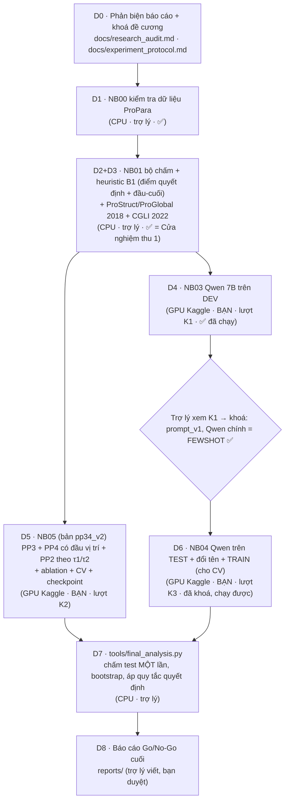

# PIPELINE TỔNG QUAN + BẢN ĐỒ MÃ NGUỒN

> File này trả lời 3 câu hỏi: **(1) pipeline gồm những bước nào, nối với nhau ra sao; (2) mỗi file làm gì; (3) chạy cái gì, ở đâu, ra cái gì.**
> Tiến độ từng bước xem `HANDOFF_STATUS.md`. Chi tiết thí nghiệm xem `EXPERIMENT_LOG.md`. Đối chiếu từng mục với báo cáo PDF xem `docs/DOI_CHIEU_BAO_CAO.md`.
> **Cập nhật lần cuối:** 19/10/2026 khoảng 23h55 (đã có kết quả K1). Bao gồm: CGLI + heuristic đầu-cuối, đầu dự đoán vị trí, PP2 theo τ1/τ2, checkpoint, K2 đổi tên output thành `pp34_v2`.

---

## 1. Câu hỏi nghiên cứu và ý tưởng của pipeline

**Câu hỏi:** Qwen 7B và các phương pháp có sẵn đã giải bài toán **chuyển đổi thực thể ngầm** (X bị tiêu thụ để tạo ra Y, kể cả khi X/Y không được nhắc trong câu) tốt đến đâu? Phương pháp của nhóm (PP2 + PP3 + PP4) có còn đáng làm không?

**Cách trả lời:** đưa **mọi hệ thống** vào **cùng dữ liệu** và **cùng bộ chấm**, rồi so sánh bằng thống kê có kiểm soát:

```
               ┌──────────────────────── CÙNG DỮ LIỆU (ProPara chuẩn hoá) ────────────────────────┐
               │                                                                                  │
   Heuristic B1 ──┤                                                                               ├──► CÙNG BỘ CHẤM ──► So sánh + thống kê ──► KEEP / PIVOT /
   ProStruct 2018 ┤   (đều nhận câu + tên thực thể, KHÔNG được thấy đáp án, trừ phép thử ORACLE)    │    (PAIR_F1,          (bootstrap theo     CONSIDER STOP /
   ProGlobal 2018 ┤                                                                               │     lát ngầm,          đoạn, CV 5 phần)    INCONCLUSIVE
   CGLI 2022    ──┤                                                                               │     Q3 chính thức)
   Qwen 7B      ──┤                                                                               │
   PP2+PP3+PP4  ──┘                                                                               │
               └──────────────────────────────────────────────────────────────────────────────────┘
```

---

## 2. Sơ đồ pipeline (các bước, ai chạy, chạy ở đâu)



Dạng chữ, để đọc khi không xem được sơ đồ:

```
D0 Phản biện + khoá đề cương ............................ ✅  (trợ lý)
 └─ D1 NB00 Dữ liệu ProPara ............................. ✅  CPU, trợ lý
     └─ D2+D3 NB01 Bộ chấm + heuristic + ProStruct/ProGlobal + CGLI ✅  CPU, trợ lý  ← Cửa nghiệm thu 1
         ├─ D4 NB03 Qwen 7B trên DEV .................... ✅  GPU Kaggle, BẠN (K1): Qwen chính = FEWSHOT, dev 0,377
         │    └─ trợ lý khoá cấu hình ................... ✅
         │         └─ D6 NB04 Qwen trên TEST + đổi tên + train ⏳  GPU Kaggle, BẠN (K3), chạy được ngay
         └─ D5 NB05 (pp34_v2) PP3 + PP4 + ablation + CV . ⏳  GPU Kaggle, BẠN (K2)
              (K2 chạy độc lập với K1, chạy song song được)
D7 final_analysis.py: chấm test kín, thống kê ........... ⬜  CPU, trợ lý (khi có K1+K2+K3)
D8 Báo cáo Go/No-Go cuối ................................ ⬜  trợ lý viết, bạn duyệt
```

**Vì sao số notebook không theo thứ tự chạy:** số được đặt theo bản đồ trong MASTER_PROMPT (02 = tái hiện baseline bài báo, chưa làm, tuỳ chọn). **Thứ tự chạy thật: 03 (K1) → 05 (K2) → 04 (K3).**

---

## 3. Từng bước: đầu vào → làm gì → đầu ra → điều kiện qua

| Bước | Notebook / file | Đầu vào | Làm gì | Đầu ra chính | Điều kiện qua bước |
|---|---|---|---|---|---|
| D0 | `docs/research_audit.md`, `docs/experiment_protocol.md` | báo cáo PDF + 3 file kế hoạch | Kiểm tra từng con số và định nghĩa của báo cáo; khoá giả thuyết, thước đo, quy tắc quyết định **trước khi** có kết quả | 12 phát hiện V1–V12; protocol **v1.5**; bản đối chiếu `DOI_CHIEU_BAO_CAO.md` | Protocol khoá xong ✅ |
| D1 | `notebooks/00_propara_data_audit.ipynb` | ProPara gốc (GitHub, ghim commit) | Chuẩn hoá; suy nhãn CREATE/DESTROY/MOVE/NONE; cờ nhắc; thay đổi ngầm; 533 cặp vàng; điểm quyết định; chia CV theo chủ đề; mẫu 80 cặp cho người chấm | dữ liệu chuẩn, `cv5_by_topic.csv`, `gold_audit_sample.csv`, `dataset_validation.md` | 29 kiểm tra, 0 FAIL ✅ |
| D2 | `notebooks/01_metrics_heuristics.ipynb` | dữ liệu + evaluator chính thức | Xây bộ chấm `PAIR_F1` + gọi evaluator gốc (`Q3_OFFICIAL`); kiểm thử; tái hiện heuristic Bảng 3 (B1a/b/c); chạy heuristic đầu-cuối B1-E2E; chấm dự đoán công bố của ProStruct, ProGlobal, **CGLI** | bảng hệ thống tham chiếu (test: CGLI 0,545 · ProStruct 0,252 · B1-E2E 0,222 · ProGlobal 0,127) | Hồi quy đúng điểm chính thức 0,545/0,519; 0 FAIL ✅ |
| D4 | `notebooks/03_qwen7b_dev.ipynb` (**K1**) | dữ liệu (tự tải) + Qwen2.5-7B-Instruct | Smoke 3 đoạn train → nếu đạt thì chạy dev: Q0 trực tiếp, Q1 có ví dụ, Q2 từng bước, Q3 + ràng buộc, Q4 oracle | dự đoán dev, điểm dev, tỉ lệ JSON hợp lệ, thời gian/VRAM | Smoke đạt, JSON hợp lệ ≥ 90% |
| D5 | `notebooks/05_pp3_pp4_dev_cv.ipynb` (**K2**) | dữ liệu + roberta-base + WikiHow | PP3: trích cặp X→Y từ WikiHow (gán nhãn từ loại), đo độ phủ, học E(X,Y). PP4: huấn luyện 6 hệ thống × 3 seed, mỗi hệ thống có **đầu dự đoán vị trí**; checkpoint mỗi epoch + dừng sớm; ablation; **PP2 theo công thức (11)** (xác suất tồn tại + lưới τ1, τ2); CV 5 phần M3 vs M0c; biến thể đổi tên | điểm dev ± SD (cả PAIR_LOC), biểu đồ loss/F1, biểu đồ PP2, CV + bootstrap, **test lưu kín**, checkpoint tốt nhất 6 hệ thống. Output `pp34_v2/` | Mọi biến thể chạy xong; có kết quả CV |
| D6 | `notebooks/04_qwen7b_test_locked.ipynb` (**K3**) | cấu hình đã khoá từ K1 | Qwen trên test (mọi chế độ) + biến thể đổi tên | **test lưu kín**, điểm đổi tên trên dev | Chạy xong, đủ file kín |
| D7 | `tools/final_analysis.py` | output K1 + K2 + K3 | Chấm test **một lần**; bootstrap Qwen-chính vs M3, M3 vs M0c, **M3 vs CGLI, Qwen vs CGLI**; **CV 486 đoạn: Qwen-chính vs M3, M3 vs M0c**; chấm hậu xử lý v2 trên dev; áp điều kiện quyết định §7 | `final_results.json`, `final_table.md` | — |
| D8 | `reports/…` | tất cả kết quả | Viết báo cáo Go/No-Go | `go_no_go_final.md` | Giảng viên duyệt |

---

## 3b. CÁC PHƯƠNG PHÁP ĐƯỢC SO SÁNH: mã trong kế hoạch ↔ tên trong notebook ↔ trạng thái

Mã B0–B2c, L0–L5, M0–M3 lấy từ `PIPELINE_GO_NO_GO_PROPARA_QWEN7B.md` §7.1. Tên trong notebook là tên xuất hiện trong bảng kết quả.

| Mã kế hoạch | Phương pháp | Tên trong notebook | Ở đâu | Cách có kết quả | Trạng thái |
|---|---|---|---|---|---|
| **B0** | Phương pháp gốc ProPara 2018 | `ProStruct_2018`, `ProGlobal_2018` | NB01 | Chấm lại **file dự đoán công bố** bằng cùng bộ chấm (test) | ✅ test: PAIR_F1 0,252 / 0,127 |
| B0 | ProLocal 2018 | — | — | File công bố dùng tên thực thể đã lemma hoá, không khớp đáp án | ⏸ bỏ qua (yếu hơn ProStruct) |
| **B1a** | Ngẫu nhiên trong ứng viên | `random` | NB01 mục 8 | Trên 133 điểm quyết định ngầm (giống Bảng 3 báo cáo) | ✅ 50,1% / 40,1% |
| **B1b** | Ngẫu nhiên trong thực thể không được nhắc | `random_unmentioned` | NB01 mục 8 | như trên | ✅ 59,6% / 41,4% |
| **B1c** | Thực thể được nhắc gần nhất | `nearest_mention` | NB01 mục 8 | như trên | ✅ 75,1% / 32,3% |
| **B1-E2E** | Heuristic **đầu-cuối** (luật từ khoá + B1c cho ô ngầm), không dùng vàng | `B1_E2E_RULE+NEAREST`, `B1_E2E_RULE_ONLY` | NB01 mục 9 | Chạy đầy đủ để có PAIR_F1 so được với các hệ thống khác | ✅ test 0,222 / 0,259 |
| **B2** | **CGLI** (COLING 2022) | `CGLI_2022` | NB01 mục 9; `final_analysis.py` | Chấm lại **file dự đoán test công bố của tác giả** (repo Mayer123/CGLI) bằng cùng bộ chấm | ✅ test: PAIR_F1 **0,545**, @nguồn ngầm 0,452, @đích ngầm 0,091; Q3 chính thức 0,724 |
| B2b | MeeT (EACL 2023) | — | — | Tìm nhanh bằng GitHub search API chưa thấy mã/dự đoán (chưa tìm kỹ) | ⬜ chỉ trích số bài báo, ghi “không so trực tiếp” |
| B2x | XPAD (2019) | — | — | Không xuất cặp X→Y (theo báo cáo); tìm nhanh chưa thấy dự đoán công khai | ⬜ tham khảo |
| L0 / Q0 | Qwen trực tiếp | `QWEN_DIRECT` | NB03 (dev), NB04 (test) | Chạy Qwen2.5-7B-Instruct | ✅ dev 0,217 · test ⏳ K3 |
| L1 / Q1 | Qwen có ví dụ (train) — **Qwen chính** | `QWEN_FEWSHOT` | NB03, NB04 (+ train cho CV) | | ✅ dev **0,377** · test ⏳ K3 |
| L2 / Q2 | Qwen từng bước | `QWEN_STRUCTURED` | NB03, NB04 | | ✅ dev 0,318 (JSON hợp lệ 81%) · test ⏳ K3 |
| L3 / Q3 | Qwen + luật tồn tại | `QWEN_CONSTRAINED` (v1), `QWEN_CONSTRAINED_V2` (sửa tồn tại ban đầu trước; đăng ký sau K1) | NB03, NB04, final | hậu xử lý, không gọi lại mô hình | ✅ dev v1 0,033 · v2 chờ zip K1 |
| L4 / Q4 | Qwen biết trạng thái đúng trước câu (ORACLE) | `ORACLE_PREV_STATE` | NB03, NB04 | bảng riêng, không so đầu-cuối | ✅ dev 0,425 (ô ngầm D 60%, C 73%) |
| L5 | PP1 chấm vét cạn Yes/No | — | — | Không chạy (331.804 câu hỏi; ưu tiên thấp theo kế hoạch) | ⬜ |
| **M0** | Gán nhãn độc lập | `M0` | NB05 | Huấn luyện RoBERTa+BiLSTM | ⏳ K2 |
| M0c | M0 + luật tồn tại khi giải mã | `M0c` | NB05 | Cùng mô hình M0 | ⏳ K2 |
| M1 | M0 + PP2 | (mục 10 của NB05) | NB05 | Công thức (11): xác suất tồn tại (biên CRF) + lưới τ1, τ2 trên dev; điểm khoá τ1=0,1, τ2=0,9 | ⏳ K2 |
| M3-no-pair | CRF, không điểm cặp | `CRF_NOPAIR` | NB05 | | ⏳ K2 |
| M3-no-E | CRF + điểm cặp, không tri thức E | `CRF_NOE` | NB05 | | ⏳ K2 |
| M2r | E xáo trộn ngẫu nhiên (ở đây = M3 với log E xáo trộn; kế hoạch gốc: M1 + điểm cặp ngẫu nhiên) | `CRF_RANDE` | NB05 | | ⏳ K2 |
| **M3** | PP2+PP3+PP4 đầy đủ | `CRF_FULL` | NB05 | | ⏳ K2 |
| M2 (kế hoạch) | M1 + E(X,Y), không giải mã chung | — | — | **Không làm**: điểm cặp ψ chỉ có nghĩa trong giải mã chung | ⚠️ khác kế hoạch, đã khai báo trong protocol |
| M3-beam/exact (kế hoạch) | So giải mã xấp xỉ với chính xác | — | — | Không cần: n ≤ 8 nên luôn giải mã chính xác | ⚠️ khác kế hoạch |

**So sánh chính sẽ báo cáo (test, cùng bộ chấm, bootstrap theo đoạn):** M3 vs CGLI · M3 vs M0c · Qwen-chính vs M3 · Qwen-chính vs CGLI, trên PAIR_F1 và các lát ngầm. Lát ngầm còn được đo thêm bằng CV 5 phần (M3 vs M0c).

---

## 4. BẢN ĐỒ MÃ NGUỒN: mỗi file làm gì

### 4.1. `src/`: mã lõi

Mọi notebook **nhúng nguyên văn** các file này vào, nên notebook tự chạy được trên Kaggle mà không cần file ngoài.

| File | Công dụng (1 câu) | Hàm/lớp quan trọng | Dùng ở |
|---|---|---|---|
| `propara_core.py` | **Nền dữ liệu:** đọc ProPara, suy nhãn, cờ nhắc, thay đổi ngầm, cặp vàng, điểm quyết định, chia CV | `build_record` (một đoạn → bản ghi chuẩn) · `derive_label` (công thức 1) · `is_mentioned` (cờ nhắc) · `gold_pairs_report` (533 cặp D×C) · `official_q3_conversions` (bản sao luật Q3 chính thức) · `decision_points` (57/76 điểm) · `count_constraint_violations` (vi phạm tồn tại) · `cv_folds_by_topic` · `gold_audit_sample` · `lift_table`, `pp2_counts` (tái hiện Bảng 2, PP2) | mọi notebook |
| `propara_metrics.py` | **Bộ chấm chung** cho mọi hệ thống | `evaluate` (chấm toàn bộ: PAIR_F1, lát ngầm, F1 từng nhãn, độ chính xác ô ngầm, tồn tại, vi phạm) · `official_q3` (gọi evaluator gốc) · `to_official_action_rows` (đổi dự đoán sang định dạng chính thức) · `paired_bootstrap_pair_f1` (khoảng tin cậy chênh lệch, lấy mẫu theo đoạn) · `mcnemar_exact` · `action_rows_to_prediction` (đọc dự đoán ProStruct/ProGlobal) | 01, 03, 04, 05, final |
| `propara_heuristics.py` | **Heuristic mốc (B1)** + phép chẩn đoán | `decision_point_table` (B1a/B1b/B1c trên điểm quyết định, Bảng 3) · `rule_nearest_e2e` (**B1-E2E**: heuristic đầu-cuối không dùng vàng) · `rule_only_e2e` · `all_none` · `oracle_mentioned_only` (chẩn đoán “mù ngầm”, dùng vàng) | 01, 03, 05 |
| `propara_llm.py` | **Phần Qwen:** viết prompt, đọc JSON trả về, đổi sang dự đoán chuẩn | `build_messages` (prompt cho 4 chế độ) · `select_fewshot` (ví dụ chỉ từ train) · `extract_json` (bóc JSON, sửa lỗi nhỏ, phát hiện bị cắt) · `parse_to_prediction` · `entity_resolver` (khớp tên LLM viết với thực thể) · `apply_existence_constraints` (chế độ Q3) · `assemble_oracle` (chế độ Q4) | 03, 04, final |
| `propara_pp3.py` | **PP3:** khai thác cặp X→Y từ WikiHow + bộ chấm E(X,Y) | `extract_pairs_pos` (7 mẫu của báo cáo + gán nhãn từ loại) · `mine_corpus` (quét WikiHow) · `coverage` (công thức 24–26) · `build_training_pairs` (dương + 3 loại âm) · `train_pair_scorer` (E = σ(uᵀWv + aᵀu + bᵀv + c), BCE) · `logE_matrix` (log E cho mọi cặp thực thể của đoạn) | 05 |
| `propara_pp4.py` | **PP4:** RoBERTa + BiLSTM + điểm đơn φ + điểm cặp ψ + **CRF giải mã chung chính xác** + **đầu dự đoán vị trí** (cụm danh từ) + **xác suất tồn tại cho PP2** (`crf_existence_marginals`, `existence_probs`) | `crf_log_partition` / `crf_viterbi` / `crf_nll` (CRF trên 2^n trạng thái tồn tại) · `PP4Model` (6 biến thể: M0, CRF_NOPAIR, CRF_NOE, CRF_FULL…) · `featurize` · `train_variant` (huấn luyện, chọn epoch theo dev, **checkpoint mỗi epoch, dừng sớm**) · `predict_all` | 05 |
| `propara_robust.py` | **Kiểm tra khái quát:** đổi tên thực thể bằng từ vô nghĩa, nhãn giữ nguyên | `nonce_variant`, `nonce_records` | 04, 05, final |
| `*_tests.py` (core, metrics, llm, pp4) | **Kiểm thử tự động**: core 16 + metrics 17 + llm 13 + pp4/CRF 6 = 52 kiểm thử; mỗi notebook chạy chúng trước, hỏng là dừng | `run_all()` | mọi notebook |

### 4.2. `tools/`: công cụ của trợ lý

| File | Công dụng |
|---|---|
| `build_nb00.py`, `build_nb01.py`, `build_nb03.py`, `build_nb04.py`, `build_nb05.py` | **Sinh ra** các notebook `.ipynb` tương ứng từ mã trong `src/` (nhúng mã + evaluator vào notebook). Sửa `src/` xong thì chạy lại file này để cập nhật notebook |
| `nb_common.py` | Các ô dùng chung cho notebook 01+: cấu hình, tải dữ liệu ProPara theo commit ghim + kiểm SHA-256, kiểm tra môi trường, nhúng mã |
| `final_analysis.py` | **Bước D7:** chấm một lần mọi dự đoán test đã lưu kín, so sánh có kiểm định, áp quy tắc quyết định, xuất bảng cuối |

### 4.3. Các thư mục khác

| Đường dẫn | Là gì |
|---|---|
| `notebooks/` | 5 notebook. **Bạn chỉ chạy 03, 05, 04 trên Kaggle.** 00, 01 trợ lý đã chạy |
| `vendor/aristo_propara_evaluator.zip` | Mã chấm **chính thức** của ProPara (allenai, Apache-2.0), giữ nguyên văn, kèm dự đoán công bố của ProStruct/ProGlobal |
| `vendor/cgli_propara_test_outputs.tsv` | Dự đoán test **công bố** của CGLI (repo Mayer123/CGLI@9c910de, GPL-3.0), chỉ dùng làm dữ liệu để chấm |
| `kaggle_upload/propara-raw-v1.zip` | Dữ liệu ProPara gốc, dùng khi Kaggle không bật được Internet |
| `annotation/gold_audit_A.xlsx`, `gold_audit_B.xlsx` | File để **2 người chấm độc lập** 80 cặp vàng (4 nhãn theo PIPELINE §5.5: NHAN_QUA_RO / CHI_DUNG_CHUAN_PROPARA / KHONG_RO / CO_THE_SAI; định nghĩa chi tiết cần nhóm thống nhất). Bước T16, ưu tiên P1, không bắt buộc cho Go/No-Go |
| `results/kaggle/` | Kết quả lấy từ Kaggle (`03.txt` = K1) |
| `results/00_local_cpu_run/`, `results/01_local_cpu_run/` | Kết quả thật của 00, 01 (trợ lý chạy CPU) |
| `results/03_local_pipeline_test_TINY_RANDOM_MODEL/` | Chỉ là kiểm thử luồng mã bằng mô hình ngẫu nhiên, **không phải kết quả** |
| `reports/go_no_go_preliminary.md` | Báo cáo sơ bộ (sẽ cập nhật khi có kết quả) |
| `docs/` | `research_audit.md` (phản biện V1–V12), `experiment_protocol.md` (đề cương khoá, v1.5), `DOI_CHIEU_BAO_CAO.md` (đối chiếu từng mục báo cáo PDF), `KAGGLE_RUN_PLAN.md` (các lượt Kaggle) |

---

## 5. Notebook nào dùng file nào, xuất gì

| Notebook | Mã nhúng | Chạy ở | Thư mục output trên Kaggle | File quan trọng nhất |
|---|---|---|---|---|
| 00 | core | CPU | `propara_audit_v1/` | `reports/audit_summary.json` |
| 01 | core, metrics, heuristics + evaluator | CPU | `propara_metrics_v1/` | `summary_01.json`, `results/reference_systems.csv` |
| 03 (K1) | core, metrics, heuristics, llm + evaluator | GPU | `qwen7b_dev_v1/` | `summary_03.json`, `predictions/dev_*.jsonl`, `raw_outputs/` |
| 05 (K2) | core, metrics, heuristics, pp3, pp4, robust + evaluator | GPU | `pp34_v2/` | `summary_05.json`, `sealed_test_predictions/`, `checkpoints/*_best.pt`, `figures/` |
| 04 (K3) | như 03 + robust | GPU | `qwen7b_test_v1/` | `summary_04.json`, `sealed_predictions/` |

---

## 5b. Lịch sử phiên bản notebook (để biết bản đang chạy có còn hợp lệ không)

| Notebook | Bản | Thời điểm | Thay đổi | Bản cũ còn dùng được? |
|---|---|---|---|---|
| 03 (K1) | bản đầu (~12:50) → bản hiện tại (~22:24) | 19/10 | Chỉ thêm khả năng tiếp tục sang phiên mới (khôi phục `raw_outputs/`). Prompt, mô hình, cách sinh và cách chấm **không đổi** | **Có**, kết quả tương đương |
| 05 (K2) | `pp34_v1` (~14:00) | 19/10 | Bản đầu: 6 hệ thống, PP3, CV, NONCE | **Chỉ làm phép so sánh phụ** (“không có đầu vị trí”); không đúng protocol v1.4 |
| 05 (K2) | `pp34_v2` (~23:20, chỉnh lần cuối 20/10 ~00:15) | 19/10–20/10 | + checkpoint mỗi epoch, dừng sớm, khôi phục sang phiên mới · + **đầu dự đoán vị trí** · + **PP2 theo τ1/τ2** · đổi tên output · (00:15) checkpoint gọn hơn, tự cài NLTK | **Bản chính**: dùng file mới nhất |
| 04 (K3) | `qwen7b_test_v1`, bản khoá (~23:55) | 19/10 | Dùng nguyên văn mã sinh của 03; **đã khoá theo K1**: Qwen chính = FEWSHOT, thêm train cho CV, thêm hậu xử lý v2 | Bản trước khoá **chưa chạy** → dùng bản này |
| 01 | `propara_metrics_v1` | ~22:54 | + CGLI, + heuristic đầu-cuối B1-E2E | trợ lý chạy, PASS |

**Không** Add Input output `pp34_v1` vào notebook `pp34_v2`: tên khác nhau nên notebook sẽ không khôi phục nhầm.

## 5c. Việc còn mở (chưa có trong pipeline)

| Việc | Vì sao chưa làm | Cần gì |
|---|---|---|
| ~~Qwen chạy train để đưa vào CV~~ | — | ✅ **đã thêm vào K3** (Qwen chính, 389 đoạn train; CV 486 đoạn trong `final_analysis.py`) |
| Tập test thứ hai CUTL/NHK (báo cáo §5) | Chính báo cáo ghi “chưa xác nhận dữ liệu” | Nhóm cung cấp/xác nhận dữ liệu |
| Rà tính mới PP3 (ConceptNet `MadeOf`, bài “Knowledge-Aware Procedural Text Understanding…”) | Cần đọc tài liệu | Làm trong báo cáo cuối |
| Nguồn tri thức thay thế WikiHow | Chỉ cần nếu độ phủ thấp | Quyết định sau K2 |
| PP1, chưng cất LLM | Kế hoạch xếp ưu tiên thấp (P2) | Ngoài phạm vi đợt này |
| MeeT, XPAD | Tìm nhanh chưa thấy mã/dự đoán | Tìm kỹ hơn hoặc chỉ trích số bài báo |

---

## 6. Thuật ngữ dùng trong mã

| Thuật ngữ | Nghĩa |
|---|---|
| `PAIR_F1` | Thước đo chính: P/R/F1 trên bộ (câu, nguồn, đích), khớp chính xác, đúng chiều |
| `PAIR_LOC_F1` | Như PAIR_F1 nhưng phải đúng cả vị trí của đích (cần đầu dự đoán vị trí) |
| `B1-E2E` | Heuristic đầu-cuối: luật từ khoá + “nhắc gần nhất” cho ô ngầm, không dùng đáp án |
| `τ1, τ2` | Ngưỡng xác suất tồn tại của PP2 (công thức 11); điểm khoá τ1=0,1, τ2=0,9 |
| `@src_imp`, `@tgt_imp`, `@any_imp` | Lát cặp có nguồn ngầm / đích ngầm / ít nhất một phía ngầm (không được nhắc trong câu) |
| `Q3_OFFICIAL` | Điểm “Conversions” của evaluator chính thức ProPara (để so với bài báo) |
| `M0` / `M0c` | Mô hình gán nhãn độc lập / cùng mô hình đó + luật tồn tại khi giải mã |
| `CRF_NOPAIR`, `CRF_NOE`, `CRF_RANDE`, `CRF_FULL (=M3)` | CRF không điểm cặp / có điểm cặp nhưng không tri thức E / E xáo trộn / đầy đủ PP3 + PP4 |
| `QWEN_DIRECT/FEWSHOT/STRUCTURED/CONSTRAINED` | Qwen Q0 / Q1 / Q2 / Q3 |
| `ORACLE_PREV_STATE` | Qwen Q4, được cho trạng thái đúng trước câu t (chỉ để chẩn đoán, không so đầu-cuối) |
| `NONCE` | Biến thể đổi tên thực thể bằng từ vô nghĩa |
| “lưu kín” | Dự đoán test được ghi ra file nhưng **không chấm** trong notebook; chỉ chấm một lần ở D7 |
